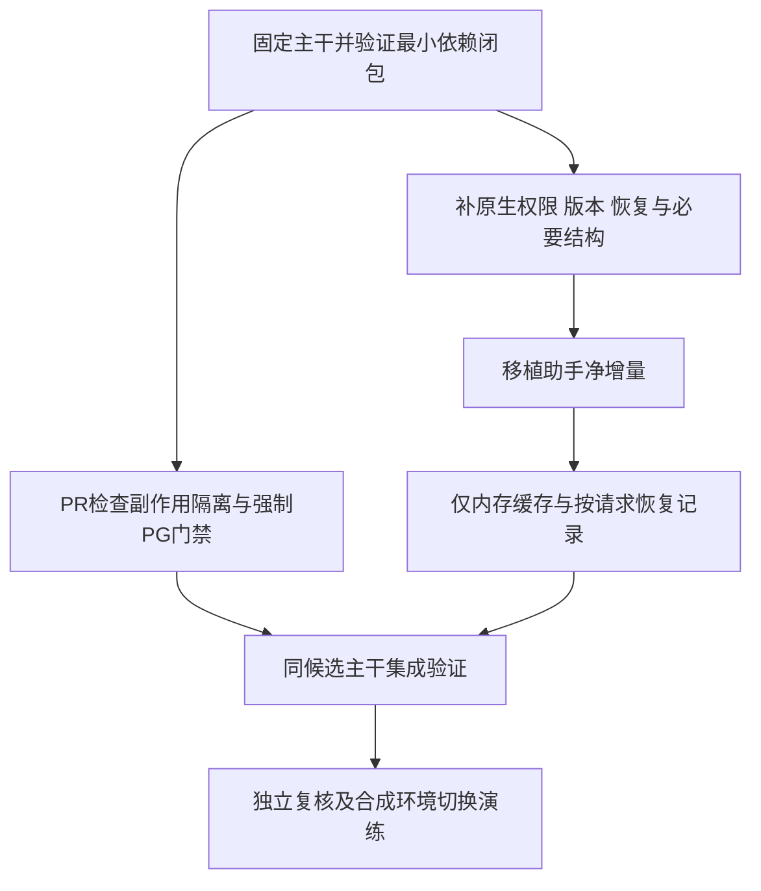

# NP 主干集成：下一阶段实施与验收计划 v0.1

2026-11-19。**当前阶段只做准备与方案；业务实现、工作流修改、实际迁移、合并及部署均未启动。**

## 1. 本轮结论

产品范围继续保持窄版：**本人已有 draft，只改摘要，原生保存后重开核对来源。** 主干整合须先补最小前置能力，不能把目录前缀转换当作完成集成。

建议分开评审“主干基础与检查门禁”和“助手/缓存移植”两个工作包。必要时由两个有依赖关系的 PR 承载；不按代理人数拆 PR。是否需要独立基础 PR，以下述依赖闭包与实际基线结果裁定。

### 固定输入

| 对象 | 固定版本/状态 | 用法 |
|---|---|---|
| main | d9c92fbd583a0cbbf7f9b4c071e1f2329981f4d7 | 当前目标基础，从它新建准备分支；不是原脏工作树的本地 main HEAD |
| PR #47 首切片 | 2d659d9dd750f49ddb1f517746e22851392231a6，Draft | 已通过窄版工程审查的源候选；不改投 main、不直接合并 |
| 首切片应用 | 4c184d5d46f1e101d3ff0ced04f62ebd0b16d6f3 | 代码取舍依据；后续仅证据/文档与断言补强 |
| 冻结父 | bcd1b8992b3f3450d5ab406afd74336cc282eece | 用于提取助手净增量，不能当作 main 的祖先 |
| PR #46 | 6ef97953811e4f8ce37016dcaf04d542e5fe133b，Draft，未合并 | 仅作既有接案协作实现参考，不能冒充 main 已有能力 |

`source-baseline.json` 已逐项登记：112 个变化路径，其中非 docs 33 个（后端16、前端9、脚本7、根配置1），docs79。两个完整祖先集合交集为零，源11个提交、main114个提交，根分别为 bcd1b899 与 689b536b。没有因对象库的 bad object 错误就推定无共同历史。

## 2. 主代理复核裁决

| 事项 | 采纳/修订后的决定 |
|---|---|
| 目录映射 | backend/X → main 根 X；前端/脚本不剥前缀。8 个共享文件候选均不同于 main，全部按净增量和实际契约移植；禁止整包覆盖 |
| Login | 冻结父等于 main，但首切片结果不等于 main；同步导航修复需要保留，不能“同名即跳过” |
| 大文件 hunk | 5 组 Batch 挂接/6 组 handler 挂接只是 NP 净增量，不包含冻结父已具备、main 尚缺的基础能力；“补这几组就能运行”尚无证据 |
| 版本与权限 | main 已有持久认证会话和客户授权；main 原生接案尚无 source 的 draft_revision/expected_revision 契约。版本锁、原生恢复 DTO 与相关写入者必须先收口 |
| 来源与材料证据 | 源 PG/浏览器回归依赖其真实材料版本栈；main 未找到对应 MatterCollaborationHandler/material_files。不能删减原保护断言、仅看数据库行不变就冒称相同文件链路通过 |
| CI | main 有6套工作流，Actions已启用，近期定时运行有成功也有失败；“PR47没有CI”不等于main没有CI。新NP门禁尚未实现 |
| 自动外部动作 | PR 条件排除了部署/推镜像，但仍配置评论、Codecov和按secrets条件的Slack/邮件。未核实际发送；本轮不创建PR，也不修改权限或停用Actions |
| CI 改造范围 | 下一阶段先隔离 PR 的外传/通知并补关键 NP 检查，不为首切片整体替换6套流水线或重建发布平台；不触发任何发布入口 |
| 缓存 | 推荐试用构建接案内容仅内存，保留无正文恢复记录。先处理旧正文与双标签恢复标识，不把sessionStorage/普通退出视为保密方案 |

本轮发现/修正的原始映射与CI表述保留在各专题报告的复核记录；以上为实施依据。所有源码事实是静态核验，未宣称已运行主干集成。

## 3. 必须补齐的最小闭包

在后续第一次代码提交前，形成逐文件依赖清单：**源路径/固定blob → main路径 → 调用点 → 缺失能力 → 验证用例 → 原工作包已计或新增**。遗漏函数、生产表/列/索引、真实入口、前端字段或测试夹具都不能只记“后续补”。

最小闭包至少包含：

1. 当前账号/在职律师/对象所有权与客户授权；复用 main 已有 AuthTokenSession 和 AuthorizationService，重新确认返回码与会话撤销语义。
2. 原生详情/列表/恢复返回同一服务端 revision；新旧保存均在事务中比较并推进，不以浏览器时间或模型字段作版本。
3. 所有会写摘要、保留来源路径或相关 metadata 的可达写入者清单；写后源指针与版本不得被其他原生入口破坏。未纳入的流程明确阻止，不默默放行。
4. `np_description_source_revision` 只由服务端严格保存建立；旧全量来源保护、未知 metadata 保全、来源/回执/墓碑原子性保留。
5. PG 实际结构：case_intakes、客户端/主体的受保护字段、来源和回执表及唯一索引。000086 目前空闲只是文件号事实，不是可独立执行或可回滚的证明。
6. 原生表单字段、局部保存资格、服务端恢复投影、离开确认与已保存状态一致；未知/旧版本不覆盖当前文字。
7. 原回归所需的主体、材料与文件版本基础。若必须引入完整案件协作/审批/材料平台，先拆基础范围评审，不把整套 final5 借“前置”之名带入助手 PR。

### 迁移取舍已知事实

| 编号 | PR46（未合并） | 冻结/首切片基线 | 当前决定 |
|---|---|---|---|
| 000082 | intake_submission_snapshots | intake_collaboration_mvp（inbox/approval/client_creation_requests） | 同号不等义，按表/列/约束对照，不重复执行 |
| 000083 | client_creation_idempotency | approval_supplement_replies | 不按编号自动套用 |
| 000084 | intake_workflow_inbox | matter_collaboration（材料文件+case_tasks） | 文件保护依赖单独评审，不借此引入整个任务模块 |
| 000085 | 此PR无该文件 | case_task_change_audit | 没有证明是NP核心前提，默认不因“源fixture执行过”强制移植 |
| 000086 | 此PR无该文件 | narrow_pilot（两表、两唯一约束，外键仅case_intakes） | 核心结构明确；是否保留号段在主干闭包/重基线后冻结 |

上述82–85是源验证库的历史基线，不是NP核心的已证必需序列。源文件API与保护测试还需要材料文件子集；不能用“86只依赖case_intakes”推导整套原回归已可独立运行。main bootstrap是v14、源是v15，是否需要某个结构差异须逐项证明，不把版本号升级本身当作完成。

**未完成闭包即不得启动助手移植包。** 允许先做有界的主干基线/缺项验证；不能为维持原估算而删掉关键安全断言。

## 4. 分阶段工作包与依赖

| 包 | 允许实施的工作 | 完成标准/交付 |
|---|---|---|
| M0 基线与闭包 | 在新分支验证 main 原基线；确定是否依赖 PR46 的最小子集；枚举相关读写和表结构；核对所有脚本/忽略规则 | main 固定SHA下的首失败、依赖清单和“可直接进入/须基础包”结论；无旧PASS自动继承 |
| M1 原生基础 | 局部迁移必需的revision、原生读写/恢复、相关写入保护和必要权限/表字段；沿用主干已有服务 | 原生并发/恢复/权限回归实际通过；非目标流程不会旁路覆盖；缺少文件版本基础时先另评范围 |
| M2 CI 收口 | 在实施分支局部隔离PR评论、Codecov、消息和发布动作；新增/复用检查job | 关键PG缺失/Skip/无测试/失败均红；不使用continue-on-error或passWithNoTests逃逸；不改真实部署设置 |
| M3 助手移植 | 新Go文件落根目录；移植8共享文件净增量；映射脚本build/cd/migrations路径；保持NP构建标签故障入口 | 原生按钮仍唯一写入口，只有description；不复制backend整包、不把故障头带进普通生产构建 |
| M4 缓存策略 | 原生业务缓存门控、旧正文处置保护、必要预填限制、按请求恢复记录、明确未保存提示、HTTP缓存绕过 | C01–C12通过；不清无关数据、不引入自动草稿/加密仓库/离线框架 |
| M5 实际集成 | root main与Redis、HTTP/浏览器/PG/构建联合验证；保留原fixture回归 | 源与目标差异、真实入口及检查对象绑定到同一候选；fixture PASS不冒充main PASS |
| M6 独立复审与演练 | 未参与实现者核验并执行；仅在合成环境演练升级/回滚、重启、单实例 | 同候选独立证据和允许/禁止清单；不连接试用服务器、不发布、不合并 |

M1/M2可在写入范围隔离后并行；M3依赖M1；M4接在M3已稳定的原生入口上；M5/M6依赖相关实现与门禁，不能并行宣称全部通过。

### 人员/代理分工建议

| 责任 | 写入范围 | 交接约束 |
|---|---|---|
| 后端执行者 | 原生接案revision、必要模型/结构、随后NP handler/router | M1提交并复核后才进入M3；不与另一人同时写大handler/router |
| 前端执行者 | 表单恢复/挂接、随后缓存策略与恢复Hook、对应行为测试 | M3表单基线冻结后才进入M4；不同时改同一Batch页面 |
| CI执行者 | 必需工作流/合成初始化与命令回执脚本 | 可并行准备；不得改业务语义或放宽本地/数据库隔离保护 |
| 主代理/负责人 | 范围、依赖、集成、裁决与证据一致性 | 接收实际diff和首失败，不按子代理“完成”直接验收 |
| 独立验证者 | 只读审核与固定候选隔离复跑 | 不参与被审实现，不自行修改代码/合并/部署 |

## 5. CI 与实际入口的具体合同

- Go从仓库根构建，前端从frontend构建；不在main继续使用backend/go.mod或默认cmd/server入口。
- 保留源本机 Docker Desktop 限制；CI另用明确的合成PG初始化步骤，不为方便运行CI去放宽本地脚本的远程环境拒绝规则。
- NP PG测试保持既有隔离校验：127.0.0.1:18790、np_first_slice_dev、显式NP_TEST_DSN；PG16.14、Redis7，镜像/工具链与锁文件固定到实际验证值。不能以CONFLICT_INTEGRATION_PG_DSN的另一组冲突测试代替NP测试。
- 先验证DB身份、bootstrap及所需追加迁移、两张NP表/唯一索引；没有PG、DSN错误或结构缺失立即失败。不能只起容器然后让Go测试Skip。
- 必跑源适用的原生7项、上下文3项、PG10项、工厂日志/审计，以及前端5套33项和四条fixture浏览器链；新增缓存/主干测试另列。关键用例名称缺失或Skip也必须失败，不能仅看进程退出0。
- `-race -count=1` 真实运行；输出JSON测试事件、完整argv、退出码与执行时间。空build stdout仍须显式记录exit=0。
- `npm ci`、type-check、关键Jest、build采用锁文件；不以空测试放行。已有全库lint/广域工作流失败应区分历史基线与新增回归，不能顺手改大量不相关代码使其变绿。
- 浏览器标准命令显式使用隔离配置，禁止复用已有前端。原fixture故障头只在构建标签程序中；真实main断线验收使用外置合成故障代理，不给正式handler新增测试后门。
- 真实main联调采用独立网络/卷、临时合成凭据与回环映射，生产式schema检查且不靠development AutoMigrate补表；先核对配置和外部连接清单再启动。主干当前尚未运行这些步骤。
- 敏感接案/助手路由显式绕过任何响应缓存读取/写入，返回private,no-store；Redis仍启用验证真实路径。旧缓存缺陷、空缓存或请求头都不能作为权限边界。
- 构建只校验不推镜像；不用真实外部模型、SaaS、真实案件、真实服务器或生产密钥。测试trace、token和请求正文不上传公开artifact；只留脱敏结果与结构证据。
- CI记录head_sha、base_sha、实际checkout/test_merge_sha、工作区状态与build commit。PR事件的默认GITHUB_SHA可能是合并测试提交，不能混称为分支head。[GitHub官方事件说明](https://docs.github.com/en/actions/reference/workflows-and-actions/events-that-trigger-workflows)。

## 6. 主干集成验收矩阵（下一阶段，全部 NOT_RUN）

| ID | 场景/必须证明 | 证据与门禁 |
|---|---|---|
| I01 | main原生基线可复现，新增回归与历史失败分开 | main实际SHA、argv、退出码、首失败；历史失败不被藏掉 |
| I02 | 根目录映射、依赖闭包、脚本路径及构建产物正确 | 映射/依赖清单、普通构建及NP标签构建；不含多余backend目录 |
| I03 | 真实登录登记会话；退出/撤销/过期/非在职/非律师拒绝 | 实际main+Redis+PG证据；兼容token不绕过助手要求 |
| I04 | 本人/他人草稿、客户撤权与角色变化逐次鉴权 | 两账号和管理员不扩权；源码与HTTP/PG事实相符 |
| I05 | 列表/详情/恢复同revision，新旧写入并发只一方成功 | PG行锁与真实并发；旧页文字保留，状态和来源不被旁路改变 |
| I06 | 摘要/源包/指针/回执同事务，保留大整数及未知字段 | PG前后快照；原生创建与两条metadata重建拒绝伪造指针 |
| I07 | 多轮、人工修改、到期与晚到回包不自动覆盖 | 既有关键组件/PG用例与真实页面，来源资格和文字分别判断 |
| I08 | 提交前/后真实TCP断线、同键重放/异参、unknown/墓碑 | 数据库commit与连接时序；不依赖只模拟UI报错 |
| I09 | 主体、材料两版文件和对照草稿未改变 | 对目标已有的真实文件栈上传/下载逐字核对＋PG散列；基础栈缺失则此项不得通过 |
| I10 | root main实际链路，Redis启用时无敏感缓存/过期授权复用 | 两用户、撤权/版本变化、预置旧缓存场景；与fixture入口分列 |
| I11 | CI缺PG、缺DSN、Skip或关键测试缺失确实变红 | 至少一份负向和一份正常workflow证据；无自动评论/上传/通知/推送/部署 |
| I12 | 合成环境升级、回滚、进程重启，最多一实例承接助手请求 | 来源/回执/墓碑持久；旧前端关闭；不能回退到会破坏来源协议的未集成main或down删除表 |
| I13 | 助手默认关闭、非试点角色/原生新建与非摘要入口不被错误改路由 | 特别核对source Hook的eligible目前仅看对象/版本/投影；主干不能让全部角色自动走仅限在职本人律师的严格协议。有来源历史仍禁止旧全量旁路，不能为兼容而降级 |

## 7. 缓存验收矩阵（下一阶段，全部 NOT_RUN）

详见[缓存提案](cache-policy-proposal.md)。输入只用独特虚构canary；“没有命中某词”是结构检查的一部分，不单独证明全部事实正确。

| ID | 场景/必须证明 | 核对方法 |
|---|---|---|
| C01 | 手工/助手应用后，接案业务正文不写localStorage或sessionStorage | 检查试点表单全部已知字段/源包/预填键、两种登录持久模式与助手关闭；仅允许最小恢复记录 |
| C02 | 刷新/重新登录只恢复已保存的服务端草稿与来源 | 独立新页面、PG版本、原菜单重开；不自动还原来源授权或覆盖人工输入 |
| C03 | 未保存离开、切对象和账号有明确提示；退出/返回不泄露旧内容 | 应用内跳转、浏览器返回、失效token；不把关闭事件当作可靠保存 |
| C04 | 结果未知后刷新仍可按原request_id回查，GET unknown不删除 | 值仅三个字段；新键保存被阻止；已丢冻结体不得重组请求 |
| C05 | 401/403/408/429/499/网络错误/digest mismatch保留；仅三个409确定拒绝清理 | 原22个Hook回归＋页面；输入保留，不重新扩大清键白名单 |
| C06 | 禁止/耗尽浏览器存储时先阻止请求发出 | 实际拦截Storage写入异常，断言服务端没有该写入/回执 |
| C07 | 同源双标签先读空、A/B各保存，A终态不删除B未决标识 | 同一个browser context的两个page，真实共享localStorage；故意交错响应、刷新后逐笔回查，不能用两个独立context冒充 |
| C08 | 退出A→登录B不展示A业务或恢复详情；A重新登录仍可回查 | 账号键空间、服务端授权、只留无正文标识；不因退出清未决键 |
| C09 | 旧v1/v2/指纹/预填有确定处置，不自动丢用户未保存正文 | 临时旧缓存夹具、先保存重开/明确放弃再定向处理；不清整站、不删其他账号/模块/np-save |
| C10 | 来源、回执及接案响应禁止读取/写入缓存 | 头部与实际Redis/响应行为同时验证；no-store不能只转成一分钟TTL |
| C11 | 旧np-save格式兼容，切换时旧版本标签停写 | 按request去重、只终态清理自己的记录；不在旧写入者活动时破坏性迁移 |
| C12 | 仅内存策略不改变原生保存、防覆盖、文件保全和来源回执 | 完整I05–I09回归；助手开关/模型失败不重新启用正文持久化 |

## 8. 估算与范围控制

原全窄版 **50–80人日、含缓冲60–96人日** 基于final5可复用能力，不是当前main上的固定集成承诺。本轮未记录可用于折算人日的真实实现工时，不将Agent墙钟时间当成人日。

下一阶段先做M0实际基线与闭包验证，再逐包给出“原W包已计/本轮新增/与验证包重叠”去重表。缓存、CI、原生版本和文件基础分别计一次，作者验证与独立复核的实际不同工作分别说明；不把旧全量迁移、完整PR46、全部文件能力重复塞入每一包。

主干基础若能局部补齐，后续按M1–M6安排原生后端、前端/缓存、CI与独立验证责任人。若必须整合完整案件协作/审批/材料平台，须先拆出基础迭代并重估，**不继续沿用50–80作为承诺，也不为保持数字删掉验收**。本准备稿不报一个缺少实际基线支持的总交付日期。

## 9. 本轮完成与后续放行

- 本轮完成：隔离准备分支、固定版本、三项GLM并行只读审查、主代理源码/统计复核、缓存提案及本实施/验收计划、PR正文准备。
- 本轮未做：业务代码/工作流/配置修改，Go/npm构建，Docker/PG/Redis/浏览器启动，缓存清理，Actions触发，创建PR、合并、真实迁移或部署。
- main/PR47若前进，先重核受影响差异；不改写历史审查对象。首切片原PASS保留，主干新门禁维持NOT_RUN。
- 下一阶段开工需明确接受窄版范围、最小基础包边界与缓存取舍；实现后再独立评审。计划本身不授权任何清理真实缓存、迁移真实数据库、发送通知或部署。

### 本轮复审记录

GLM Flash分别负责目录、前置与CI静态初稿；主代理逐项复核后形成最终文档，纠正了Login取错版本、跨对象库谱系推断、脚本路径遗漏、把82–85整组误当硬依赖、PG/Redis变量、空测试放行退路及PR通知条件。目录执行者另只读复核了最终计划的基线、映射、依赖顺序与估算边界，未发现新的矛盾；未逐项执行验收矩阵。缓存与CI最终策略是主代理复核设计，不称已通过独立运行验证。

已实际完成的结构核验：33个非docs路径的main blob逐项读回、源分支固定SHA及clean状态、JSON解析和相对链接检查、公开上传内容扫描。它们不代替main构建、实际PG/Redis/浏览器或CI新门禁的运行证据。主干源码、现有工作流、首切片分支与冻结基线均未修改。
