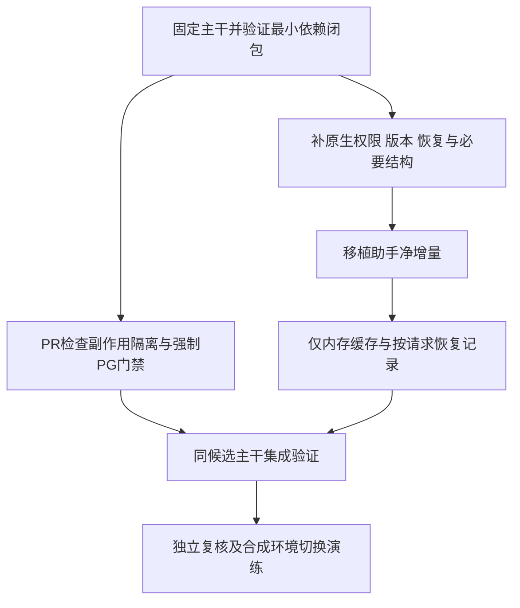

# NP 主干集成：下一阶段实施与验收计划 v0.3

2026-11-20修订；v0.1形成于2026-11-19。**冻结准备轮只做准备与方案；当前M0执行见末节补记，业务实现、工作流修改、真实迁移、合并及部署均未启动。** 本版在v0.2（888e7f1983c93e146c7aeb153f756bc57b07bd74）上吸收GPT-6.2 Astra只读审核及主代理复核的5项问题、3项建议。修订规则、门禁与工作量归属；文档处理不等于风险关闭，所有新增运行验收仍为NOT_RUN。

## 1. 本轮结论

产品范围继续保持窄版：**本人已有 draft，只改摘要，原生保存后重开核对来源。** 主干整合须先补最小前置能力，不能把目录前缀转换当作完成集成。

建议分开评审“主干基础与检查门禁”和“助手/缓存移植”两个工作包。必要时由两个有依赖关系的 PR 承载；不按代理人数拆 PR。是否需要独立基础 PR，以下述依赖闭包与实际基线结果裁定。

### 固定输入

| 对象 | 固定版本/状态 | 用法 |
|---|---|---|
| main | d9c92fbd583a0cbbf7f9b4c071e1f2329981f4d7 | 当前目标基础，从它新建准备分支；不是原脏工作树的本地 main HEAD |
| PR #47 首切片 | 2d659d9dd750f49ddb1f517746e22851392231a6，Draft | 已通过窄版工程审查的源候选；不改投 main、不直接合并 |
| 首切片应用 | 4c184d5d46f1e101d3ff0ced04f62ebd0b16d6f3 | 代码取舍依据；后续仅证据/文档与断言补强 |
| 冻结父 | bcd1b8992b3f3450d5ab406afd74336cc282eece | 用于提取助手净增量，不能当作 main 的祖先 |
| PR #46 | 6ef97953811e4f8ce37016dcaf04d542e5fe133b，Draft，未合并 | 仅作既有接案协作实现参考，不能冒充 main 已有能力 |

`source-baseline.json` 已逐项登记：112 个变化路径，其中非 docs 33 个（后端16、前端9、脚本7、根配置1），docs79。两个完整祖先集合交集为零，源11个提交、main114个提交，根分别为 bcd1b899 与 689b536b。没有因对象库的 bad object 错误就推定无共同历史。

## 2. 主代理复核裁决

| 事项 | 采纳/修订后的决定 |
|---|---|
| 目录映射 | backend/X → main 根 X；前端/脚本不剥前缀。8 个共享文件候选均不同于 main，全部按净增量和实际契约移植；禁止整包覆盖 |
| Login | 冻结父等于 main，但首切片结果不等于 main；同步导航修复需要保留，不能“同名即跳过” |
| 大文件 hunk | 5 组 Batch 挂接/6 组 handler 挂接只是 NP 净增量，不包含冻结父已具备、main 尚缺的基础能力；“补这几组就能运行”尚无证据 |
| 版本与权限 | main 已有持久认证会话和客户授权；main 原生接案尚无 source 的 draft_revision/expected_revision 契约。版本锁、原生恢复 DTO 与相关写入者必须先收口 |
| 来源与材料证据 | 源 PG/浏览器回归依赖其真实材料版本栈；main 未找到对应 MatterCollaborationHandler/material_files。不能删减原保护断言、仅看数据库行不变就冒称相同文件链路通过 |
| CI | main 有6套工作流，Actions已启用，近期定时运行有成功也有失败；“PR47没有CI”不等于main没有CI。新NP门禁尚未实现 |
| 自动外部动作 | PR 条件排除了部署/推镜像，但仍配置评论、Codecov和按secrets条件的Slack/邮件。未核实际发送；本轮不创建PR，也不修改权限或停用Actions |
| CI 改造范围 | 下一阶段先隔离 PR 的外传/通知并补关键 NP 检查，不为首切片整体替换6套流水线或重建发布平台；不触发任何发布入口 |
| 缓存 | 推荐试用构建接案内容仅内存，保留无正文恢复记录。先处理旧正文与双标签恢复标识，不把sessionStorage/普通退出视为保密方案 |

本轮发现/修正的原始映射与CI表述保留在各专题报告的复核记录；以上为实施依据。所有源码事实是静态核验，未宣称已运行主干集成。

### v0.3审核处置索引

以下MI-R编号仅用于本轮主干准备，不替代旧I0的R编号。静态证据绑定§1的main/首切片SHA；Astra原报5项P1、3项P2，主代理保留分级作为处置优先级，不把推演路径写成已复现事故。八项均为**规则已纳入、实现/运行未验收**。

| 编号 / 原审核项 | 复核后处理规则 | 必须落实的阶段与验收 |
|---|---|---|
| MI-R01 / P1 缓存别名遗漏 | main `internal/router/router.go:399`另有`/api/v1/cases/intake-workbench/:id`，与接案/助手前缀共用显式缓存绕过；不能仅加no-store | M0路由清单、M4实现；I10/C10实际验证 |
| MI-R02 / P1 历史保护未知时放行 | 源`backend/internal/handlers/narrow_pilot_write.go:75-96`在HasTable=false且allowed为空时放回全量更新。须区分明确从未迁移/启用的旧环境与已启用保护但结构缺失/查询失败；后者失败关闭，不能由开关或白名单推定无历史 | M0结构/生命周期及锁序契约、M1后端；I14及I05/I13 |
| MI-R03 / P1 检测完成回写 | main `internal/repositories/conflict_repository.go:246-278`按ID整体回写，`demo_aggregate_handler.go:2366-2387`同步路径还有第二次metadata回写；异步服务`:198`同样调用repository。全部纳入取数revision保护 | M0写入者清单、M1原生基础；I15及I05/I06 |
| MI-R04 / P1 仅内存后丢未保存编辑 | 源Batch保存期间摘要仍可编辑，保存并退出成功后直接离开；重载仅保护请求发出后的新编辑。保存A期间输入B必须留页并保留B；加载服务端前先确认已有未保存内容 | M3挂接与M4防丢失；C13/C14及I07/I08 |
| MI-R05 / P1 CI产物边界矛盾 | main `tests.yml:258-272`上传报告/截图，Playwright保留失败trace/video；fuzzing有产物上传/下载链。允许白名单脱敏结构证据，禁止原始正文、token、浏览器产物及未审目录上传，见§5 | M0事件/产物流清单、M2；I11 |
| MI-R06 / P2 未知fuzzing输入假绿 | 六处if修复之外，校验输入枚举；未知值显式失败。汇总以实际选中job结果和必需证据裁决，不以零crasher文件推定成功 | M2；I11输入/汇总负向证据 |
| MI-R07 / P2 旧标签关闭顺序 | 暂停旧版本新操作，先核实回执和仅内存/session暂存，经保存重开或明确放弃后才关闭旧标签；不能先关再核对 | M4旧内容处置；C09/C11 |
| MI-R08 / P2 回执身份核对 | 源`frontend/src/components/intake/useNarrowPilotSave.ts:66-68,85-89`缺完整身份核对。终态必须匹配发出请求的request_id、对象ID（现有回执id对应intake_id）及action（如响应有此字段）；committed/no_change还须有有效revision。错配/缺项保留原键、输入，不换键 | M3保存Hook与M4恢复；I16/C04/C05/C07 |

MI-R02不要求把所有从未启用试点的旧库停写；MI-R05不要求关闭全部GitHub证据上传。这两项以本文限定规则为准，不照搬更大的整改范围。八项没有新增通用平台或第二个业务写入口。

## 3. 必须补齐的最小闭包

在后续第一次代码提交前，形成逐文件依赖清单：**源路径/固定blob → main路径 → 调用点 → 缺失能力 → 验证用例 → 原工作包已计或新增**。遗漏函数、生产表/列/索引、真实入口、前端字段或测试夹具都不能只记“后续补”。

最小闭包至少包含：

1. 当前账号/在职律师/对象所有权与客户授权；复用 main 已有 AuthTokenSession 和 AuthorizationService，重新确认返回码与会话撤销语义。
2. 原生详情/列表/恢复返回同一服务端 revision；新旧保存均在事务中比较并推进，不以浏览器时间或模型字段作版本。
3. 所有会写摘要、保留来源路径或相关 metadata 的可达写入者清单；写后源指针与版本不得被其他原生入口破坏。未纳入的流程明确阻止，不默默放行。
4. `np_description_source_revision` 只由服务端严格保存建立；旧全量来源保护、未知 metadata 保全、来源/回执/墓碑原子性保留。
5. PG 实际结构：case_intakes、客户端/主体的受保护字段、来源和回执表及唯一索引。000086 目前空闲只是文件号事实，不是可独立执行或可回滚的证明。
6. 原生表单字段、局部保存资格、服务端恢复投影、离开确认与已保存状态一致；未知/旧版本不覆盖当前文字。
7. 主体、材料与文件版本保护先按原完整I09要求登记；M0出口必须依下表裁决材料基础独立迭代，或明确批准限定的主干首轮范围。未裁决前不得自动缩小验收，不把整套final5借“前置”之名带入助手PR。

### 迁移取舍已知事实

| 编号 | PR46（未合并） | 冻结/首切片基线 | 当前决定 |
|---|---|---|---|
| 000082 | intake_submission_snapshots | intake_collaboration_mvp（inbox/approval/client_creation_requests） | 同号不等义，按表/列/约束对照，不重复执行 |
| 000083 | client_creation_idempotency | approval_supplement_replies | 不按编号自动套用 |
| 000084 | intake_workflow_inbox | matter_collaboration（材料文件+case_tasks） | 文件保护依赖单独评审，不借此引入整个任务模块 |
| 000085 | 此PR无该文件 | case_task_change_audit | 没有证明是NP核心前提，默认不因“源fixture执行过”强制移植 |
| 000086 | 此PR无该文件 | narrow_pilot（两表、两唯一约束，外键仅case_intakes） | 核心结构明确；是否保留号段在主干闭包/重基线后冻结 |

上述82–85是源验证库的历史基线，不是NP核心的已证必需序列。源文件API与保护测试还需要材料文件子集；不能用“86只依赖case_intakes”推导整套原回归已可独立运行。main bootstrap是v14、源是v15，是否需要某个结构差异须逐项证明，不把版本号升级本身当作完成。

M0执行与证据见[本轮基线报告](m0/baseline-report.md)。用户已确认I09路线B；这不授权M1或实际材料迁移。

**未完成闭包即不得启动助手移植包。** 允许先做有界的主干基线/缺项验证；不能为维持原估算而删掉关键安全断言。

### M0出口：I09材料边界必须二选一

| 路线 | 实施范围 | 验收和放行条件 |
|---|---|---|
| A 保留完整I09 | 先拆独立的最小材料基础迭代，提供真实上传/不可变版本/下载及必要结构；不自动引入case_tasks或全部审批功能 | I09须实际证明两版文件逐字下载、材料/主体/对照草稿保全；基础未完成就不放行等价主干集成 |
| B 限定主干首轮 | 不新增材料版本栈，只验证main现有case_materials及实际已有相关记录不变；两版文件流单列后置 | 须在M0出口取得明确范围确认并冻结新测试清单：I09-MAIN必测，I09-FILES标DEFERRED/HOLD，不能记PASS、不能声称与源首切片材料能力等价 |

**本版冻结于2481a47时未选择B；本轮M0中用户已明确确认路线B，以下以该M0决定更新主干首轮范围。** M0交付必须写明选A或B、理由、影响的文件/迁移/测试和去重工作量；尚未裁决则M1/M3材料相关范围不放行。接受B是显式调整主干首轮产品/验收范围，不是测试失败后的降级办法；原首切片分支及其完整测试保持不变。

M0已按用户决定采用B，以保持首轮窄版。材料版本能力独立排期；case_materials/关联记录保全是后续实际保存链的必测项，本次schema核对不算该项通过。

本轮已确认B，本文同步§5必跑清单和I09/C12范围；M1/M3实际修改主干测试夹具前仍须按该清单交独立审核；文件相关源测试保留为后置清单，不通过Skip、删除断言或假文件变成绿色。来源绑定、主体/现有材料保全、防覆盖、真实断线与回执门禁不后置。

### M3分流：前端便利条件与服务端权限分开

严格摘要分流同时要求：已加载并核对的当前账号为在职律师、本人已有草稿、当前服务端状态为draft、版本有效、仅摘要变化，且不是新建/补正/修订模式。角色、在职状态、所有者或草稿状态未加载、缺失或不一致时，不将eligible判为true。

这些只是前端分流条件；服务端仍以当次数据库身份、会话、所有权、客户授权、draft状态和锁内revision决定是否写入。分流判断之后发生撤权/状态变化，服务器必须拒绝并保留输入和恢复标识，不能自动换键或重试全量PUT。

是否有来源历史/是否强制局部协议，须来自服务端有权读取的原生对象状态，不能仅看当前source_revision是否为空——人工解绑后仍可能有历史。若main现有DTO缺少这一事实，M0将其列为最小读契约缺项，不新增第二个业务写入口。

- 无来源历史且当前角色有原生写权限：可按原生协议保存，并继续执行同一版本/权限保护。
- 有来源历史但不满足严格摘要资格，或历史保护状态未知：阻止保存、提示重新加载或由有权律师处理；不得落回旧全量协议、清来源指针或修改前端身份来绕过。
- 助手白名单/模型开关不等同于原生严格手工保存资格；关闭助手后，已有来源保护不能解除。

### 原生写入保护补充合同（MI-R02 / MI-R03）

- M0记录“未迁移且确定从未启用保护 / 已迁移或曾启用保护 / 状态未知”的判定证据，以固定迁移清单、实际schema/索引核对及候选启停/回滚记录为准。`HasTable=false`可能掩盖查询失败，不能仅凭该布尔值、空白名单或助手关闭认定第一类；无法证明即按未知处理。主干集成候选启动前检查所需schema，不能靠AutoMigrate补齐。
- 确认从未启用的旧环境只保留其原生合同，不标记为NP候选通过。已迁移/曾启用的候选即使关闭助手，结构缺失或来源历史查询失败也拒绝相关接案写入。`有历史/无历史/未知`须在与写入一致的事务、接案行锁内判断；无历史到建立来源之间不能被旧全量请求穿透。schema异常不视为确定未提交，前端仍按未知结果保留恢复标识。
- 检测启动时不为此新增一次接案版本推进；读取检测输入时捕获revision并随同步/异步任务传递。完成回写必须在同一事务按该revision比较更新，并遵守所有写入者共用的版本推进合同；不接受只按ID更新、客户端自报revision或完成时重新取新revision代替输入版本。
- 版本不符时不写`conflict_ready`，不改接案metadata/来源指针，不执行关联cases等部分写入；有关联更新须同事务回滚。检测结果可保留为历史结果，但不冒充当前草稿结果。
- repository与同步handler重复整体metadata回写应收口为一个受保护写点，沿用现有服务/事务；只修改允许字段并保全其他metadata。若某条完成路径本轮不整合，服务端必须阻止其触及受保护接案，并验证已有在途任务不能绕过；不能只隐藏按钮或禁用助手。

## 4. 分阶段工作包与依赖

| 包 | 允许实施的工作 | 完成标准/交付 |
|---|---|---|
| M0 基线与闭包 | 在新分支验证 main 原基线；确定是否依赖 PR46 的最小子集；枚举相关读写和表结构；核对所有脚本/忽略规则 | main 固定SHA下的首失败、依赖清单和“可直接进入/须基础包”结论；无旧PASS自动继承 |
| M1 原生基础 | 局部迁移必需的revision、原生读写/恢复、相关写入保护和必要权限/表字段；沿用主干已有服务 | 原生并发/恢复/权限回归实际通过；非目标流程不会旁路覆盖；缺少文件版本基础时先另评范围 |
| M2 CI 收口 | 在实施分支局部隔离PR评论、第三方上传、消息、发布及未审产物；新增/复用检查job、输入和汇总校验 | 关键PG缺失/Skip/无测试/失败均红；不使用continue-on-error或passWithNoTests逃逸；不改真实部署设置 |
| M3 助手移植 | 新Go文件落根目录；移植8共享文件净增量；映射脚本build/cd/migrations路径；保持NP构建标签故障入口 | 原生按钮仍唯一写入口，只有description；不复制backend整包、不把故障头带进普通生产构建 |
| M4 缓存策略 | 原生业务缓存门控、旧正文处置保护、必要预填限制、按请求恢复记录、明确未保存提示、HTTP缓存绕过 | 完成C01–C14对应实现，组件与合成fixture前置检查通过；完整矩阵由M5作者集成判定；不清无关数据、不引入离线框架 |
| M5 实际集成 | root main与Redis、HTTP/浏览器/PG/构建联合验证；保留原fixture回归 | 源与目标差异、真实入口及检查对象绑定到同一候选；fixture PASS不冒充main PASS |
| M6 独立复审与演练 | 未参与实现者核验并执行；仅在合成环境演练升级/回滚、重启、单实例 | 同候选独立证据和允许/禁止清单；不连接试用服务器、不发布、不合并 |

M1/M2可在写入范围隔离后并行；M3依赖M1；M4接在M3已稳定的原生入口上；M5/M6依赖相关实现与门禁，不能并行宣称全部通过。

### 开工、执行与放行门禁（不混为一次GO）

| 关口 | 必须具备的条件 | 未具备时的边界 |
|---|---|---|
| M0有界核验 | 固定main/源SHA、隔离工作区及合成数据边界；本稿作为核验清单 | 可开展只读盘点与另行授权的隔离基线回归；八项运行检查仍NOT_RUN，本轮仅修文档 |
| M0出口 → M1/M2准备 | 路由别名、schema生命周期/历史状态、同步/异步写入者、前端退出/重载、CI事件/产物流均有责任和最小闭包；工作量去重；I09范围仍按既定A/B裁决 | 缺项先核验，不以表格齐全代替实际基线；材料未裁决不放行对应范围 |
| M1 → M3 | 同一候选的原生版本/权限回归及I14/I15通过；M0适用基础闭包已收口 | 不启动助手挂接来绕过未保护的旧写入口 |
| M2远端执行前 | 先离线核对可达事件、外部副作用和产物白名单；发布/评论/通知/第三方上传隔离，输入/汇总逻辑检查完成；遵守远端执行授权 | 可离线准备，尚不能称CI通过；I11正常与负向运行在此后完成，不能用未跑I11循环阻塞其首次验证 |
| M3/M4 → M5 | I16及C01–C14对应的保存/恢复、缓存、防丢失组件与合成fixture前置检查通过，前置M1/M2检查已满足；真实main/Redis项在M5执行 | 记录定点作者证据，不提前把完整I/C行判PASS，不用尚未执行的M5全链结果阻止首次联调 |
| M5 → M6独立复核 | 同候选适用I01–I11、I13–I16及C01–C14作者集成通过；I09后置须有明确范围记录；I12尚待M6演练 | 不把未做I12冒称通过，也不让M6的结果反过来阻塞M6首次开工 |
| M6 → 后续放行评审 | 固定候选独立复核及I12合成升级/回滚/单实例演练通过，全部适用门禁证据齐备 | 首切片PASS不继承；扩大试用、合并和部署继续HOLD，需另获相应授权与门禁 |

文档推送不等于手动运行CI或创建PR；既有工作流仍可能自动产生run，须只读记录实际状态，不能承诺“推送无Actions”。本轮不修改工作流来规避该事实。

### 人员/代理分工建议

| 责任 | 写入范围 | 交接约束 |
|---|---|---|
| 后端执行者 | 原生接案revision、必要模型/结构、随后NP handler/router | M1提交并复核后才进入M3；不与另一人同时写大handler/router |
| 前端执行者 | 表单恢复/挂接、随后缓存策略与恢复Hook、对应行为测试 | M3表单基线冻结后才进入M4；不同时改同一Batch页面 |
| CI执行者 | 必需工作流/合成初始化与命令回执脚本 | 可并行准备；不得改业务语义或放宽本地/数据库隔离保护 |
| 主代理/负责人 | 范围、依赖、集成、裁决与证据一致性 | 接收实际diff和首失败，不按子代理“完成”直接验收 |
| 独立验证者 | 只读审核与固定候选隔离复跑 | 不参与被审实现，不自行修改代码/合并/部署 |

## 5. CI 与实际入口的具体合同

- Go从仓库根构建，前端从frontend构建；不在main继续使用backend/go.mod或默认cmd/server入口。
- 保留源本机 Docker Desktop 限制；CI另用明确的合成PG初始化步骤，不为方便运行CI去放宽本地脚本的远程环境拒绝规则。
- NP PG测试保持既有隔离校验：127.0.0.1:18790、np_first_slice_dev、显式NP_TEST_DSN；PG16.14、Redis7，镜像/工具链与锁文件固定到实际验证值。不能以CONFLICT_INTEGRATION_PG_DSN的另一组冲突测试代替NP测试。
- 先验证DB身份、bootstrap及所需追加迁移、两张NP表/唯一索引；没有PG、DSN错误或结构缺失立即失败。不能只起容器然后让Go测试Skip。
- 必跑源适用的原生7项、上下文3项、PG10项、工厂日志/审计，以及前端5套33项和四条fixture浏览器链；新增缓存/主干测试另列。关键用例名称缺失或Skip也必须失败，不能仅看进程退出0。I09按用户确认的路线B执行：主干现有case_materials及关联记录保护必跑；两版文件API/材料文件栈的源用例保留在I09-FILES后置清单，不拷贝为主干必跑，不通过Skip或删除断言冒充通过。
- `-race -count=1` 真实运行；输出JSON测试事件、完整argv、退出码与执行时间。空build stdout仍须显式记录exit=0。
- `npm ci`、type-check、关键Jest、build采用锁文件；不以空测试放行。已有全库lint/广域工作流失败应区分历史基线与新增回归，不能顺手改大量不相关代码使其变绿。
- 浏览器标准命令显式使用隔离配置，禁止复用已有前端。原fixture故障头只在构建标签程序中；真实main断线验收使用外置合成故障代理，不给正式handler新增测试后门。
- 真实main联调采用独立网络/卷、临时合成凭据与回环映射，生产式schema检查且不靠development AutoMigrate补表；先核对配置和外部连接清单再启动。主干当前尚未运行这些步骤。
- 敏感路由包括`/api/v1/case-intakes`、`/api/v1/case-intake-assist`前缀和`/api/v1/cases/intake-workbench/:id`别名；在全局缓存读写之前由同一规则排除，返回private,no-store。Redis仍启用验证真实路径；计数/探针只针对业务响应缓存，不禁止合法的认证Redis访问。旧缓存缺陷、空缓存或请求头不能作为权限边界。
- 构建只校验不推镜像；不用真实外部模型、SaaS、真实案件、真实服务器或生产密钥。PR路径禁止自动评论、第三方上传、Slack/邮件、镜像推送和部署；GitHub原生artifact仅允许显式白名单的脱敏结构证据。
- M2先枚举六套workflow中PR可达的上传/下载/汇总链（包含always/failure步骤）。白名单只含脱敏的SHA/argv/时间/退出码、测试计数/结果和结构摘要；argv及测试输出也须去除凭据/正文，不能直接把原始日志、JUnit、report目录视作安全。浏览器trace、截图、video、请求/响应正文、token和未审整目录均禁止上传，不论仓库是否公开；原始验证资料仅留受控本地临时证据。
- 默认不上传，先生成到独立脱敏目录并检查路径/内容后再按显式文件清单上传；扫描不能独立证明没有敏感信息。依赖这些产物的download/summary必须同步调整，只消费同run的允许证据；必需证据缺失/被拒绝或选中job失败/取消/意外Skip时不得显示成功。保留合法脱敏证据，不为“无上传”关闭整个证据链。
- fuzzing入口只接受all/security/validators/repositories/cache/concurrency；输入缺失默认all，非空未知值由必执行的检查显式失败，不能让六个条件全false。汇总核对选中job的实际result、必需测试及证据；只允许未选中的类别Skip，零crasher或汇总job成功不能冲掉前序失败。
- CI记录head_sha、base_sha、实际checkout/test_merge_sha、工作区状态与build commit。PR事件的默认GITHUB_SHA可能是合并测试提交，不能混称为分支head。[GitHub官方事件说明](https://docs.github.com/en/actions/reference/workflows-and-actions/events-that-trigger-workflows)。

## 6. 主干集成验收矩阵（下一阶段；I09-FILES后置，其余NOT_RUN）

| ID | 场景/必须证明 | 证据与门禁 |
|---|---|---|
| I01 | main原生基线可复现，新增回归与历史失败分开 | main实际SHA、argv、退出码、首失败；历史失败不被藏掉 |
| I02 | 根目录映射、依赖闭包、脚本路径及构建产物正确 | 映射/依赖清单、普通构建及NP标签构建；不含多余backend目录 |
| I03 | 真实登录登记会话；退出/撤销/过期/非在职/非律师拒绝 | 实际main+Redis+PG证据；兼容token不绕过助手要求 |
| I04 | 本人/他人草稿、客户撤权与角色变化逐次鉴权 | 两账号和管理员不扩权；源码与HTTP/PG事实相符 |
| I05 | 列表/详情/恢复同revision，新旧写入并发只一方成功 | PG行锁与真实并发；旧页文字保留，状态和来源不被旁路改变 |
| I06 | 摘要/源包/指针/回执同事务，保留大整数及未知字段 | PG前后快照；原生创建与两条metadata重建拒绝伪造指针 |
| I07 | 多轮、人工修改、到期与晚到回包不自动覆盖 | 既有关键组件/PG用例与真实页面，来源资格和文字分别判断 |
| I08 | 提交前/后真实TCP断线、同键重放/异参、unknown/墓碑 | 数据库commit与连接时序；不依赖只模拟UI报错 |
| I09-MAIN | 主干现有主体、case_materials及实际关联记录、对照草稿未改变（NOT_RUN） | 用户已确认B；在目标保存链前后比较记录/字段散列和关联，不用空表证明保护；不声称两版文件能力等价 |
| I09-FILES | 两版文件上传、不可变版本及逐字下载保全（DEFERRED/HOLD） | 明确后置到独立材料基础；保留源用例清单，不以Skip/假文件/删除断言变成PASS |
| I10 | root main实际链路，Redis启用时接案/助手及工作台别名均无敏感缓存/过期授权复用 | 两用户、撤权/版本变化、预置旧缓存；逐路由证明业务响应缓存读写尝试为零且每次鉴权，认证Redis照常；与fixture入口分列 |
| I11 | CI缺PG/DSN、关键Skip/缺失、未知输入、选中job失败或缺证据均红；产物边界受控 | 正常与各适用负向workflow证据、类别路由表和实际结果；无自动评论/第三方上传/通知/推送/部署，仅白名单脱敏GitHub artifact；追踪upload/download/summary |
| I12 | 合成环境升级、回滚、进程重启，最多一实例承接助手请求 | 来源/回执/墓碑持久；旧前端关闭；不能回退到会破坏来源协议的未集成main或down删除表 |
| I13 | 助手默认关闭、非试点角色/原生新建与非摘要入口不被错误改路由 | 特别核对source Hook的eligible目前仅看对象/版本/投影；主干不能让全部角色自动走仅限在职本人律师的严格协议。有来源历史仍禁止旧全量旁路，不能为兼容而降级 |
| I14 | schema/来源历史保护不因助手关闭、白名单清空或查询失败解除 | 已迁移/曾启用库模拟来源表缺失、权限/查询错误及开关关闭，相关写入拒绝且PG不变；锁内无历史→首份来源与并发旧全量写不穿透；独立未迁移旧库证明兼容但不报NP PASS |
| I15 | 同步/异步检测完成都受检测输入revision约束，无二次覆盖 | 暂停检测→保存新摘要/来源→恢复同步和异步完成：拒绝旧回写，接案状态/metadata/指针及关联cases不变；匹配版本正常路径只按共同合同推进一次；检测启动不额外推进 |
| I16 | PUT/回查/放弃三条回执核对原请求身份后才清恢复键 | 注入错request_id、错对象、缺身份、非法revision及同源双标签交错回执，均保留原键与输入；正确committed/no_change及abandoned仅清本请求记录，unknown不清 |

I13必须含以下组合：本人+在职律师+draft可走严格摘要；非本人/管理员/助理/非在职/非draft不误走该分支；状态或身份未加载不误判；加载后撤权由服务端拒绝；当前来源已人工解绑但仍有历史时不能退全量；无来源历史且有原生权限的其他角色仍可使用原生入口。全部当前NOT_RUN。

M0用户已确认路线B，现以I09-MAIN作为主干首轮必测，I09-FILES明确DEFERRED/HOLD。只允许报告限定主干首轮结果，不能用I09-MAIN声称原完整I09或源材料能力等价通过；NP来源、回执、并发、真实断线及现有材料保全门禁不后置。

## 7. 缓存验收矩阵（下一阶段，全部 NOT_RUN）

详见[缓存提案](cache-policy-proposal.md)。输入只用独特虚构canary；“没有命中某词”是结构检查的一部分，不单独证明全部事实正确。

| ID | 场景/必须证明 | 核对方法 |
|---|---|---|
| C01 | 手工/助手应用后，接案业务正文不写localStorage或sessionStorage | 检查试点表单全部已知字段/源包/预填键、两种登录持久模式与助手关闭；仅允许最小恢复记录 |
| C02 | 刷新/重新登录只恢复已保存的服务端草稿与来源 | 独立新页面、PG版本、原菜单重开；不自动还原来源授权或覆盖人工输入 |
| C03 | 未保存离开、切对象和账号有明确提示；退出/返回不泄露旧内容 | 应用内跳转、浏览器返回、失效token；不把关闭事件当作可靠保存 |
| C04 | 结果未知后刷新仍可按原request_id回查，GET unknown不删除 | 值仅三个字段；新键保存被阻止；已丢冻结体不得重组请求 |
| C05 | 401/403/408/429/499/网络错误/digest mismatch保留；仅三个409确定拒绝清理 | 原22个Hook回归＋页面；输入保留，不重新扩大清键白名单 |
| C06 | 禁止/耗尽浏览器存储时先阻止请求发出 | 实际拦截Storage写入异常，断言服务端没有该写入/回执 |
| C07 | 同源双标签先读空、A/B各保存，A终态不删除B未决标识 | 同一个browser context的两个page，真实共享localStorage；故意交错响应、刷新后逐笔回查，不能用两个独立context冒充 |
| C08 | 退出A→登录B不展示A业务或恢复详情；A重新登录仍可回查 | 账号键空间、服务端授权、只留无正文标识；不因退出清未决键 |
| C09 | 旧v1/v2/指纹/预填及仅内存内容先处置，再关闭旧标签 | 包含仅sessionStorage预填/仅内存文字夹具：暂停新操作→核实未决→逐页核对→有权保存重开或明确放弃→关闭旧页→定向处理；未完成终端HOLD，不清整站/其他账号/np-save |
| C10 | 来源/回执/接案及工作台别名响应禁止缓存读写 | 三类路由及错误/撤权响应，头部、预置旧正文、业务响应缓存读写计数与实际响应同时验证；核对/sw.js注册、controller/Cache Storage，不清无关模块；no-store不能只转成一分钟TTL |
| C11 | 旧np-save格式兼容，切换时旧版本标签停写 | 按request去重、只终态清理自己的记录；不在旧写入者活动时破坏性迁移 |
| C12 | 仅内存策略不改变原生保存、防覆盖、文件保全和来源回执 | 适用I05–I08及I09-MAIN回归；I09-FILES明确后置，源完整断言保留；助手开关/模型失败不重新启用正文持久化 |
| C13 | 保存A期间继续输入B，A终态不能把B当作已保存或退出丢弃 | 延迟保存/回查返回；摘要保持可编辑时核对edit epoch：成功后B仍在、留在页面、明确提示B未保存；相同场景覆盖保存并退出、断线后回查成功，重开只见已保存A与对应来源 |
| C14 | 重新加载服务端前处理已有未保存编辑，并阻断确认后新编辑被晚到响应覆盖 | 先输入B再点重载，取消/关闭确认不发起替换且保留B；明确确认后加载，期间再输入C则晚到响应不得覆盖C；不能把返回的A误标为B/C已保存 |

C13/C14与I16共同保护“仅内存+真实回执”边界；旧终端处置未完成则该终端不得进入试用。全部新增条件仍为NOT_RUN。

## 8. 估算与范围控制

原全窄版 **50–80人日、含缓冲60–96人日** 基于final5可复用能力，不是当前main上的固定集成承诺。本轮未记录可用于折算人日的真实实现工时，不将Agent墙钟时间当成人日。

下一阶段先做M0实际基线与闭包验证，再逐包给出“原W包已计/本轮新增/与验证包重叠”去重表。缓存、CI、原生版本和文件基础分别计一次，作者验证与独立复核的实际不同工作分别说明；不把旧全量迁移、完整PR46、全部文件能力重复塞入每一包。

### v0.3去重归属账（未新增一个总估算）

下表“包内细化”指本主干准备稿既定M包，不代表已证明历史I0的每个W项都已计价。M0须回填对应原W编号、实际缺口和净增量；未核对不得先标“旧估算已含”。同一实现/一次全链复跑只计一次，M5作者集成与M6独立执行确为不同工作时分别说明。

| 项 | 实现/核验归属 | 当前计量规则与可能新增边界 |
|---|---|---|
| MI-R01 | M0路由盘点；M4缓存绕过；M5 I10/C10复跑 | 既有响应缓存包内细化，别名及探针一起计；不另立全站缓存包 |
| MI-R02 | M0生命周期/锁序；M1原生写保护；M5 I14 | 既有版本/来源保护包内细化；若生命周期判定需新基础能力，M0举证后单列净增量，不把事务整合再计到M3 |
| MI-R03 | M0同步/异步调用清单；M1检测回写；M5 I15 | 归原生相关写入者保护，不另建检测平台；异步任务若缺输入版本传递，列出具体新增字段/调用/测试，扣除已有事务保护重叠 |
| MI-R04 | M3保存挂接；M4内存防丢失；M5 C13/C14 | 单一前端改动包，退出、重载、回查共用编辑状态，不在两个包重复计实现 |
| MI-R05 | M0产物流；M2白名单及消费链；I11 | 既有CI副作用收口内细化，连同脱敏/上传/下载/汇总计一次；不整体替换六套workflow |
| MI-R06 | M2枚举/汇总检查；I11 | 与六处job条件修复同一个CI包，负向检查并入正常/异常矩阵，不另加一轮全链验证 |
| MI-R07 | M4旧内容处置；C09/C11 | 既有终端缓存迁移包内调整顺序和夹具；真实终端人工处置数量未知，单列待确认，不伪装已包含的固定工时 |
| MI-R08 | M3 Hook回执解析；M4恢复键；M5 I16/C04–C07 | 保存/恢复包内细化，三路径共用身份规则、测试分别覆盖；服务端缺字段时先列读契约缺口，不新增业务写入口 |

M0出口交付账目须包含：原W/本M包、工作对象、旧包已计证据、确需新增、重叠扣除、作者验证、独立复核、假设/待确认及净合计。此时再决定维持还是调整总范围；八条审核意见数量不能直接换算八份追加人日。

主干基础若能局部补齐，后续按M1–M6安排原生后端、前端/缓存、CI与独立验证责任人。若必须整合完整案件协作/审批/材料平台，须先拆出基础迭代并重估，**不继续沿用50–80作为承诺，也不为保持数字删掉验收**。本准备稿不报一个缺少实际基线支持的总交付日期。

## 9. 冻结准备轮完成与后续放行（2481a47历史记录）

- 本轮完成：隔离准备分支、固定版本、三项GLM并行只读审查、主代理源码/统计复核、缓存提案及本实施/验收计划、PR正文准备。
- 本轮未做：业务代码/工作流/配置修改，Go/npm构建，Docker/PG/Redis/浏览器启动，缓存清理，Actions手动触发，创建PR、合并、真实迁移或部署。
- main/PR47若前进，先重核受影响差异；不改写历史审查对象。首切片原PASS保留，主干新门禁维持NOT_RUN。
- 下一阶段开工需明确接受窄版范围、最小基础包边界与缓存取舍；实现后再独立评审。计划本身不授权任何清理真实缓存、迁移真实数据库、发送通知或部署。

### 本轮复审记录

GLM Flash分别负责目录、前置与CI静态初稿；主代理逐项复核后形成最终文档，纠正了Login取错版本、跨对象库谱系推断、脚本路径遗漏、把82–85整组误当硬依赖、PG/Redis变量、空测试放行退路及PR通知条件。目录执行者另只读复核了最终计划的基线、映射、依赖顺序与估算边界，未发现新的矛盾；未逐项执行验收矩阵。缓存与CI最终策略是主代理复核设计，不称已通过独立运行验证。

已实际完成的结构核验：33个非docs路径的main blob逐项读回、源分支固定SHA及clean状态、JSON解析和相对链接检查、公开上传内容扫描。它们不代替main构建、实际PG/Redis/浏览器或CI新门禁的运行证据。主干源码、现有工作流、首切片分支与冻结基线均未修改。

### 发布后CI观察补录

准备分支26355fc发布后，既有`.github/workflows/fuzzing.yml`出现push事件失败记录[44508335288](https://github.com/VanTam-CN/law-oa-go/actions/runs/44508335288)。REST读回jobs=0、check-runs=0，CLI提示可能是工作流文件问题；具体校验原因未取到。虽然该文件的push分支列表没有codex分支，平台仍形成了失败记录，不能只读事件过滤就承诺发布绝不会产生Actions记录。此项并入M2配置检查，当前不修改工作流、不重跑或取消现有任务；没有业务测试执行，不作为I01或I11的实际业务失败/通过。

### 2026-11-20独立复核吸收与M2限定修法

已核对六处job级条件：`.github/workflows/fuzzing.yml:73,126,175,229,287,341`使用env.TEST_TYPE。[GitHub上下文可用性表](https://docs.github.com/en/actions/reference/workflows-and-actions/contexts#context-availability)列明job级if不支持env。已确认存在这项工作流校验错误；历史run的直接平台校验明细仍未取得，不能补造注解，也未证实它是唯一问题。

M2局部修法：这六个job条件直接使用`github.event.inputs.test_type || 'all'`，保留各自类别比较；综合job仍仅在all时执行。step/run内合法的env.TEST_TYPE不机械替换，现有needs和失败传播不放宽，不在本轮改真实workflow。

M2验收需分别证明：六处上下文错误消除；push/PR/schedule缺输入时按all路由；手动选择五种类别只运行对应类别、综合job仅all；未知输入不以全Skip冒充成功；后续实际测试失败仍如实红。先做离线工作流校验和条件表核对，再在获准且已隔离外部副作用的CI路径验证。修此校验错误不等于整条CI已绿，不能略去I11强制PG/关键测试门禁。

缓存方案只完成设计收口，原生正文缓存、双标签恢复竞争及响应缓存绕过均未实现/运行；P2-3风险继续开放到M4及C01–C14验收，不能记为已关闭。

### v0.3审核与修订状态

GPT-6.2 Astra针对888e7f1提出5项P1/3项P2，主代理只读复核后形成MI-R01–MI-R08；本次仅更新方案/缓存/验收及准备说明。历史首切片PASS未撤销，也不继承至main；v0.3新增I14–I16、C13–C14及既有用例扩展全部NOT_RUN。文档复审与推送结果在本轮交付记录中说明，不将其记作运行门禁通过。

本轮文档复审：Astra独立只读检查了五份修订文档及diff，确认八项均有归属、未扩大窄版和未虚增总估算；指出M4工作包仍提前要求完整C矩阵通过。主代理已按建议同步该格，并明确M5作者集成与M6独立/I12演练的先后，避免用后续阶段结果阻塞首次执行。此为文档一致性处置记录，不是I/C运行PASS。结构检查覆盖8项编号、I01–I16/C01–C14连续表格、相对链接、历史JSON未变、docs-only和diff空白；未执行产品测试。

### M0执行补记

本轮仅在`codex/np-main-m0`执行M0，v0.3冻结对象2481a47保持可追溯；用户明确选择I09路线B后，本文同步主干必跑/后置范围。具体运行结果、原始失败、GLM回报复核及剩余门禁见[M0报告](m0/baseline-report.md)；不把已跑的构建/回归或看板接入转写为I01–I16/C01–C14全量PASS。

### M0最终封板补记（继213da4c之后）

用户已授权并完成三项收口：以[逐用例清单](m0/route-b-test-split.md)取代笼统“源适用用例”，以[依赖封板](m0/dependency-seal.md)和33条blob映射限定最小移植范围，以[净工时账](m0/net-effort-estimate.md)给出剩余25–41/缓冲30–50人日条件区间。实际行为和检查仍NOT_RUN，I09-FILES仍DEFERRED/HOLD。

§5“原生7项/上下文3项/PG10项”等为冻结准备轮的组数口径；未来必跑以新的逐名索引为准：26个Go来源项、5套前端33个展开项、4条浏览器来源场景，另列I09/I14/I15/I16/C01–C14新增计划场景及2个详情适配，不能只跑历史63项判完整通过。源continuation正向提交能力不引入；原权限/版本/脱敏语义通过主干既有读写入口覆盖，不给恢复GET加陈旧版本409门槛。

原生M1检查先于M3；NP/SQL及审计日志保护与测试在M3同阶段必跑，M4为缓存/编辑新行为，M5为实际root入口，M6为独立及合成切换。33净增量之外的必要原生目标已列明，不以backend目录改名代替实现闭包。86号在固定main基线上冻结，源86结构独立成功；基线前进则重核，不能静默占冲突编号或整组引入82–85。

本轮只授权M0文档及证据推送到codex/np-main-m0，不启动M1、不创建集成PR、不合并、不部署；正式运行门禁和实际外部兼容/切换证据不因纸面收口而消失。
