# Law OA Go 试用者操作手册

本手册面向参与小范围试用的律师、助理、冲突核查人和管理人员，按"登录 → 立案 → 冲突检查 → 审批成案 → 案件办理 → 客户管理"的实际操作顺序编写，全部截图来自当前试用环境的真实页面。

## 如何使用本手册

**三个阅读约定**：

* 正文中**加粗的文字**（如**保存草稿**、**新增客户**）都是页面上真实存在的按钮或栏目名称，可直接对照屏幕查找。
* 编号步骤（1. 2. 3.）表示需要按顺序依次执行；每一步都写了"会看到什么"，方便确认自己没有走偏。
* 标有 ⚠️ 的段落是容易出错的地方，请特别留意。

**按角色找重点**：

| 如果您的角色是 | 建议重点阅读 |
| ---- | ---- |
| 律师 | 全部章节（立案、冲突、审批主流程由您发起） |
| 助理 | 第 3、6 章（登录、立案填写） |
| 独立冲突核查人 | 第 3、7 章（登录、冲突复核） |
| 管理人员 | 第 3、8 章（登录、审批处理） |

**第一次使用，只需 10 分钟**：登录（第 3 章）→ 在工作台看一眼待办（第 4 章）→ 跟着第 6 章填一个练习立案。其余章节用到时再回来查。

---

## 目录

1. [系统简介](#1-系统简介)
2. [开始之前](#2-开始之前)
3. [登录与退出](#3-登录与退出)
4. [认识工作台](#4-认识工作台)
5. [核心业务流程总览](#5-核心业务流程总览)
6. [新建立案](#6-新建立案)
7. [利益冲突检查](#7-利益冲突检查)
8. [审批中心：复核与成案](#8-审批中心复核与成案)
9. [案件管理](#9-案件管理)
10. [客户管理](#10-客户管理)
11. [待办中心](#11-待办中心)
12. [常见问题](#12-常见问题)
13. [术语小词典](#13-术语小词典)
14. [试用版本边界](#14-试用版本边界)

---

## 1. 系统简介

Law OA Go 是一套面向小型律师事务所的案件协作系统。当前试用版本聚焦一条完整闭环：

> 律师登记客户与案件线索 → 系统自动执行利益冲突检查 → 独立核查人复核 → 审批通过后自动生成正式案件 → 律师在案件、客户和待办视图中持续协作。

试用者按照角色会看到不同的菜单。以"陈示例"（律师角色）登录后，左侧菜单包含：

| 菜单 | 用途 |
| ---- | ---- |
| 工作台 | 每日入口：待办、冲突、审批、案件动态汇总 |
| 案件管理 | 案件线索与正式案件的清单、详情、办理阶段 |
| 利益冲突检查 | 冲突检测任务队列与结果复核 |
| 客户管理 | 客户主档案、关联方、历史委托 |
| 审批中心 | 冲突审查、豁免披露、接案审批的处理入口 |
| 待办中心 | 个人待办任务的筛选与处理 |

管理员账号额外可见用户、角色、权限管理等菜单；财务角色可见代管款管理。如果某个菜单对您不可见，说明当前角色未开放该功能，属正常现象。

---

## 2. 开始之前

试用前请确认：

1. **访问地址**：试用环境由项目组发放（本地试用默认为 <http://localhost:3003>，前端页面会自动连接后端服务）。
2. **试用账号**：使用项目组分配的邮箱账号和密码登录。试用演示账号统一密码为 Demo@2026（仅限演示数据，正式启用时会为您重设）。

   | 演示账号 | 角色 |
   | ---- | ---- |
   | demo.admin@example.test | 管理员 |
   | demo.lawyer@example.test | 律师（本手册示例账号） |
   | demo.assistant@example.test | 助理 |
   | demo.finance@example.test | 财务 |
   | demo.conflict.officer@example.test | 独立冲突核查人 |

3. **浏览器**：推荐使用最新版 Chrome 或 Edge，无需安装任何插件。
4. **数据边界**：演示库中的客户、案件、冲突记录均为虚构的演练数据（例如"上海示例科技有限公司"），供操作练习使用。

---

## 3. 登录与退出

### 3.1 登录

1. 打开项目组发放的试用地址，进入登录页。
2. 输入账号（邮箱）和密码，点击**登录**按钮。
3. 看到"登录成功"提示、页面自动跳转到工作台，即登录完成。

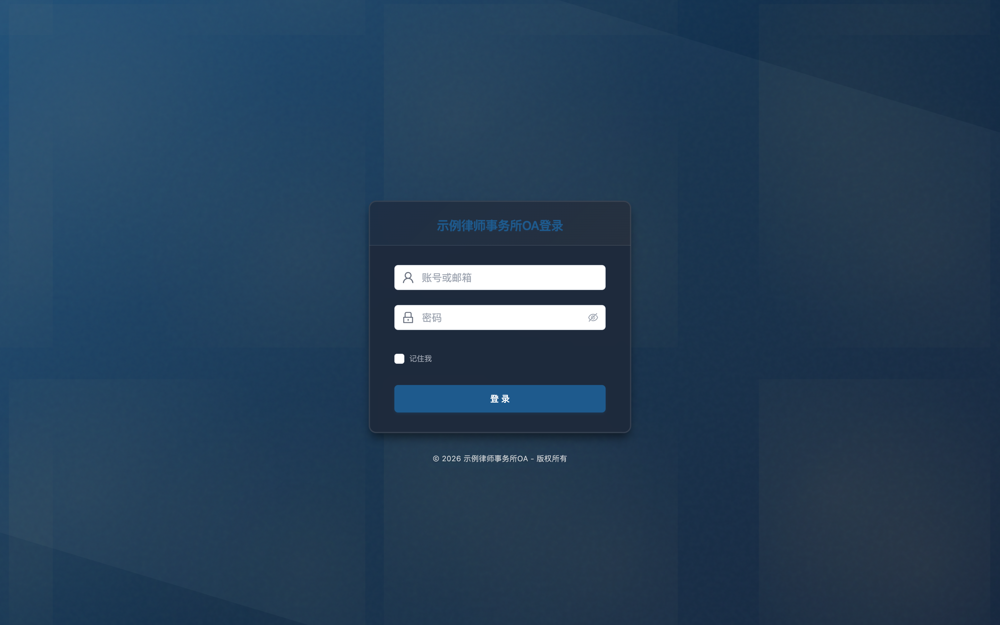

> 如果提示"登录失败，请检查账号和密码"：先核对邮箱拼写和密码大小写，仍失败请联系管理员重置（见第 12 章 Q1）。

### 3.2 退出

点击页面右上角头像，选择退出登录。系统对会话安全有保护：退出后当前访问令牌（即登录后系统发给浏览器的电子通行证）立即失效，旧令牌无法继续访问系统数据。长时间离开工位时建议主动退出。

---

## 4. 认识工作台

工作台是每日工作的第一入口，登录后默认进入。页面自上而下分为几个区域：

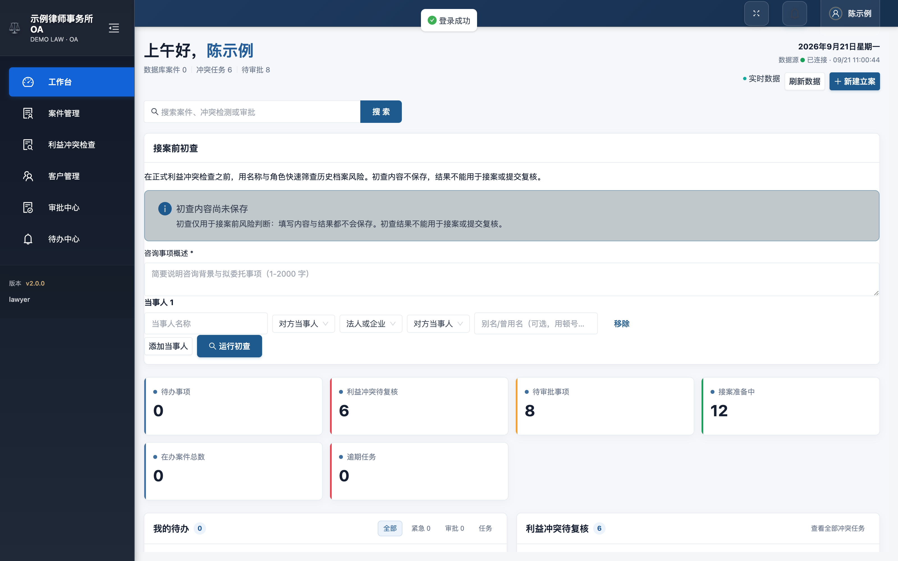

### 4.1 顶部数据卡

显示与您相关的三个关键数字：

* **数据库案件** — 与您相关的案件数量。
* **冲突任务** — 处于冲突检查流程中的任务数量。
* **待审批** — 等待审批处理的事项数量。

### 4.2 接案前初查（页面中部）

在正式利益冲突检查之前，可以用名称与角色快速筛查历史档案风险：

1. 填写"咨询事项概述"。
2. 添加当事人（可选"对方当事人"角色，区分自然人 / 法人或企业）。
3. 点击**运行初查**。

> ⚠️ **重要边界**：初查内容不会保存，初查结果只能帮助接案前的风险判断，**不能用于接案，也不能用于提交复核**。正式的冲突检查必须在立案流程中完成。

### 4.3 待办事项与冲突待复核

页面中部列出"我的待办"和最近的利益冲突待复核任务，每条任务显示客户、当前状态（如"待人工复核"）和发起时间。点击任务可直接进入对应的详情页。

### 4.4 底部统计与快捷入口

底部提供案件趋势、在办案件阶段分布、审批提醒等统计图表，以及"新建立案 / 待办中心 / 冲突检测 / 审批队列"等快捷入口，点击即可跳转。

---

## 5. 核心业务流程总览

一个案件从线索到成案，会经过以下环节。理解这条主线后，后面的操作章节都会对应到其中的某一步：

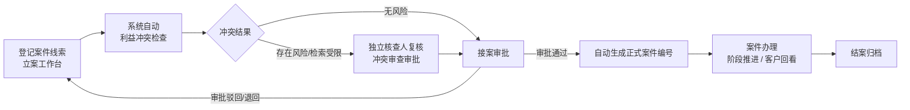

关键规则只有两条：

1. **冲突检查未完成，案件不会放行成案**。系统强制先检查、后审批。
2. **核查人独立复核**。冲突检查结果需要独立核查人人工确认，律师本人不能替代该环节。

---

## 6. 新建立案

### 6.1 进入立案工作台

入口有两处：工作台右上角的**新建立案**按钮，或"案件管理"页面右上角的**新建案件**按钮。

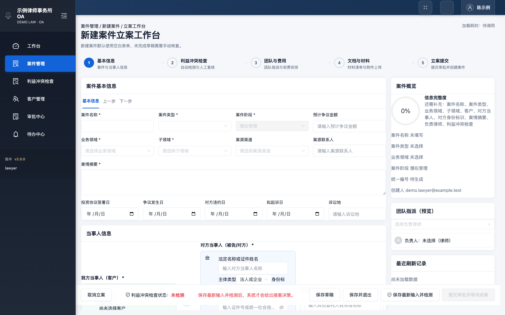

立案工作台右侧会实时显示"案件概览"和**信息完整度**百分比，并列出还缺哪些必填项；左侧表单按 5 个步骤组织。

### 6.2 五个步骤

| 步骤 | 内容 |
| ---- | ---- |
| 1. 基本信息 | 案件与当事人信息（本节详述） |
| 2. 利益冲突检查 | 系统自动检测与人工复核 |
| 3. 团队与费用 | 团队指派与收费安排 |
| 4. 文档与材料 | 材料清单与附件上传 |
| 5. 立案提交 | 提交审批并等待成案 |

### 6.3 基本信息填写要点

带 * 号的字段为必填。全部填完后，右侧"案件概览"的**信息完整度**会逐步升到 100%，并列出还缺哪些项，可随时对照检查。

**第一步：填写案件信息**

1. 填写**案件名称**（如"某公司买卖合同纠纷"），选择**案件类型**、**业务领域**和**子领域**。
2. 填写**案情摘要**，用几句话说清这是一件什么事。
3. **案件阶段**保持默认"潜在受理"即可；预计争议金额、案源渠道、案源联系人为选填。
4. 争议解决类案件可补充投资协议签署日、争议发生日、对方违约日、拟起诉日、诉讼地等时间与地点信息。

**第二步：填写当事人信息**

5. **我方当事人（客户）**：在列表中选择现有客户。找不到？说明该客户尚未建档，先到"客户管理"点击**新增客户**建档，再回到本页选择。
6. **对方当事人（被告/对方）**：填写法定名称或证件姓名、主体类型和身份标识。主体类型按对方情况选择"自然人"（个人）或"法人或企业"（公司）；对应地，身份标识类型个人选"身份证件号码"、企业选"统一社会信用代码"（营业执照上的 18 位编码），再填入相应号码。系统提示：身份标识将**加密保存**，并与名称、曾用名共同用于冲突检索。
7. 共同委托人 / 其他相关方为可选，按需添加。

**第三步：触发冲突检查**

8. 点击页面底部**保存最新输入并检测**，系统开始自动利益冲突检查。
9. 确认结果：底部"利益冲突检查状态"不再是"未检测"，检测完成后系统给出接案决策。

> ⚠️ 不点"保存最新输入并检测"就无法提交：冲突检查未完成，系统不会放行成案。

### 6.4 草稿与保存

页面底部四个按钮的区别：

| 按钮 | 作用 |
| ---- | ---- |
| **取消立案** | 中止本次立案并离开立案工作台。 |
| **保存草稿 / 保存并退出** | 保存当前已填内容，稍后可继续。 |
| **保存最新输入并检测** | 保存并立即触发利益冲突检查（推荐每次填完基本信息就点它）。 |
| **提交审批并等待成案** | 信息完整且冲突检查完成后提交，进入审批队列。 |

> ⚠️ **关于草稿恢复**：新建案件默认打开空白表单，系统不会自动带出未完成的草稿。需要继续时，到"案件管理"列表找到对应的草稿记录手动恢复。重要内容建议一次填完，或及时**保存并退出**。

---

## 7. 利益冲突检查

### 7.1 检测清单

左侧菜单进入"利益冲突检查"，看到的是冲突检测任务队列：

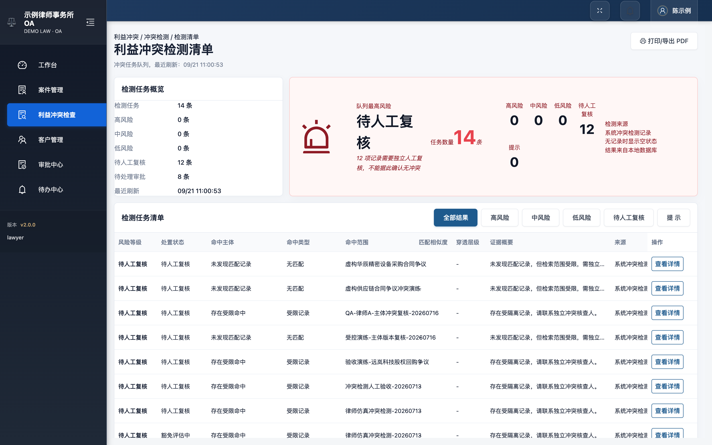

顶部"检测任务概览"汇总：检测任务总数、高风险 / 中风险 / 低风险数量、待人工复核数量、待处理审批数量和最近刷新时间。清单支持按"全部结果 / 高风险 / 中风险 / 低风险 / 待人工复核 / 提示"筛选，并可**打印 / 导出 PDF** 留档。

### 7.2 怎么读一条检测结果

从左到右看一条结果：

1. **风险等级与处置状态**：决定这条结果要不要处理、由谁处理。
2. **命中主体 / 命中类型 / 命中范围**：查到了谁、在哪个案件或客户上撞上的。
3. **匹配相似度 / 穿透层级 / 证据概要**：相似程度和判断依据。
4. **操作**：点击**查看详情**查看完整证据，核查人从这里发起复核（见 7.3）。

⚠️ 特别注意**"待人工复核"**状态：它不代表"没有冲突"。典型情形有两类：

* **未发现匹配记录，但检索范围受限** — 系统没有查到，但受数据隔离等限制，检索并不完整。
* **存在受限命中** — 命中的记录处于隔离墙保护范围内，详情对普通律师不可见。

这两类都必须转交**独立冲突核查人**人工复核，律师不能据此确认无冲突。

### 7.3 后续动作

点击行末**查看详情**进入检测详情。核查人复核后，系统会发起"冲突审查审批"（见下一章）。审批通过前，案件停留在冲突复核环节，不会成案。

---

## 8. 审批中心：复核与成案

### 8.1 审批工作台

左侧菜单进入"审批中心"。审批工作台聚合了冲突审查、豁免披露、接案审批和退回补充，形成审批闭环入口：

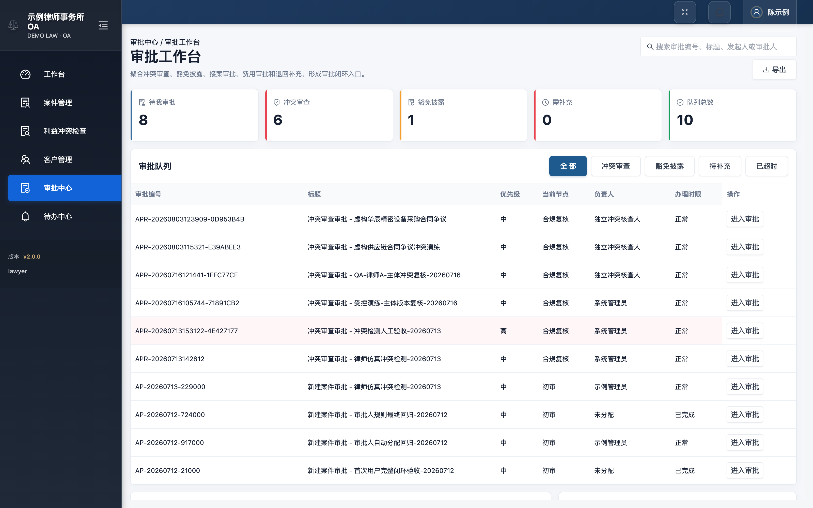

顶部统计卡显示：待我审批、冲突审查、豁免披露、需补充和队列总数。审批队列支持按"全部 / 冲突审查 / 豁免披露 / 待补充 / 已超时"筛选，每行显示审批编号、标题、优先级、当前节点、负责人、办理时限，点击**进入审批**处理。

### 8.2 处理一条审批

进入审批详情后，页面会展示该案件的冲突摘要、检测结论、当事人信息和操作区：

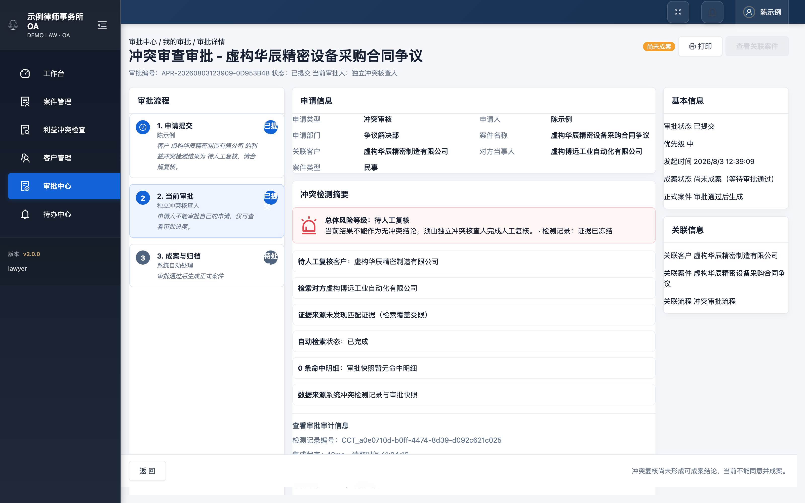

处理要点：

* 审批人核对冲突摘要与检测结论后，在操作区填写审批意见。
* 选择**通过 / 驳回 / 退回补充**等决定并提交。
* 审批有**办理时限**（超时会标记"已超时"）和多级节点（例如"合规复核"由独立冲突核查人处理，"初审"由管理员处理），当前停在哪个节点，就由对应负责人处理。

### 8.3 审批通过后会发生什么

接案审批通过后，系统**自动创建正式案件并回填案件编号**。随后：

1. 在"案件管理"列表中可以看到新案件。
2. 从审批详情可直接点击关联案件按钮跳转到案件页。
3. 客户档案的"历史委托与案件"中会同步出现该案件。

---

## 9. 案件管理

### 9.1 案件清单

左侧菜单经"案件管理"进入：

顶部统计卡显示在办案件、冲突复核中、接案审批中、待补充材料和客户总数；中部清单可按"全部 / 潜在受理 / 冲突复核 / 审批中 / 办理中 / 已结案"筛选状态。底部的**接案漏斗**（接案准备 → 冲突复核 → 接案审批 → 办理中）直观展示线索在各环节的分布。

### 9.2 案件详情

点击任意一行进入案件详情：

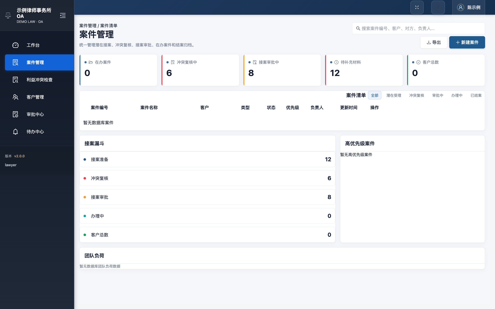

详情页提供案件概览、办理阶段状态、关联客户、下一步操作建议，以及**本案冲突复核入口**。案件阶段推进和后续主体变更都在这里操作。

> ⚠️ **数据隔离**：律师只能看到与本人相关的案件。如果列表为空，说明当前名下暂无案件数据，属正常现象。

---

## 10. 客户管理

### 10.1 客户主档案

左侧菜单进入"客户管理"。页面左侧是客户列表（含**新增客户**按钮），右侧是选中客户的主档案：

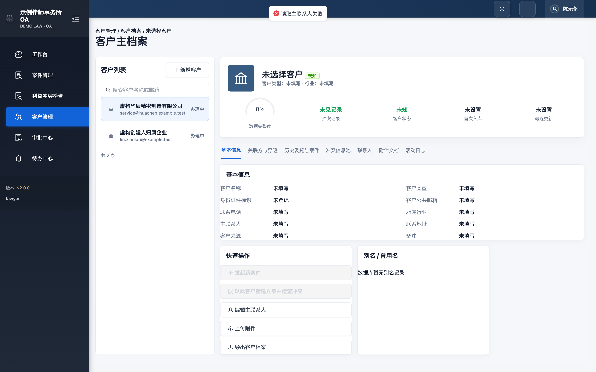

主档案用页签组织信息：

| 页签 | 内容 |
| ---- | ---- |
| 基本信息 | 客户名称、类型、证件标识、联系方式、行业、来源等 |
| 关联方与穿透 | 客户的关联企业与穿透关系 |
| 历史委托与案件 | 该客户名下的全部案件与委托记录 |
| 冲突信息池 | 与该客户相关的冲突记录汇总 |
| 联系人 | 客户的联系人清单 |
| 附件文档 | 客户相关附件 |
| 活动日志 | 档案的变更记录 |

右侧还显示**数据完整度**百分比，帮助判断档案质量。

### 10.2 快速操作

档案页提供四个快捷操作：**发起新案件**（以此客户直接进入立案并检查冲突）、**编辑主联系人**、**上传附件**、**导出客户档案**。

新客户请先在左侧点击"新增客户"建档，再回到立案流程选择该客户。

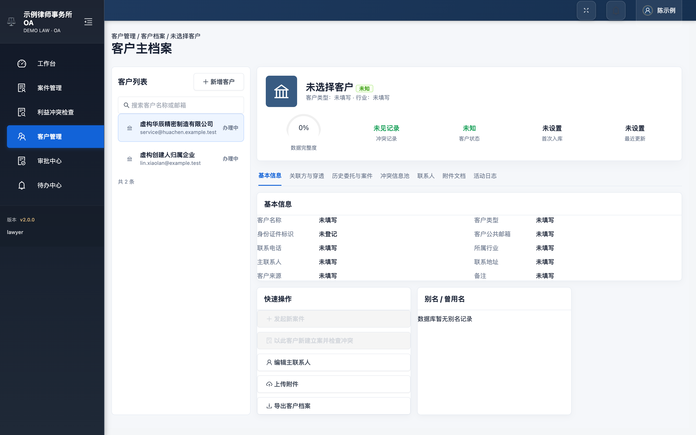

---

## 11. 待办中心

左侧菜单进入"待办中心"，集中处理分配给您的审批与任务：

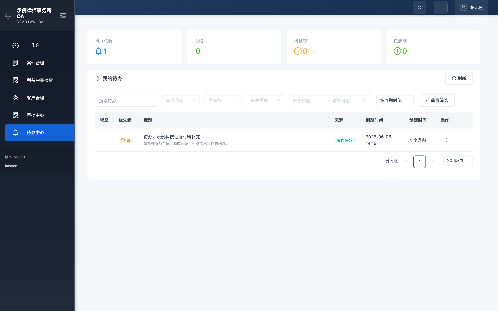

支持按类型筛选、查看详情、标记完成和延后提醒。工作台"我的待办"卡片中的"查看全部待办"也会跳转到本页。

---

## 12. 常见问题

**Q1：登录提示"登录失败，请检查账号和密码"？**
确认使用的是项目组发放的试用账号和密码（注意大小写）。多次失败后请联系管理员重置，不要反复尝试。

**Q2：打开某页面提示"无权访问 / 403"？**
当前角色未开放该功能（例如财务中心需要财务角色）。点击"返回工作台"即可，需要权限时联系管理员评估授权。

**Q3：冲突结果显示"待人工复核"，是不是就没有冲突？**
不是。该状态表示检索受限或命中了隔离记录，**必须由独立冲突核查人人工复核**，系统也明确提示"不能据此确认无冲突"。

**Q4：审批通过后在哪里找到新案件？**
左侧菜单"案件管理"列表中，或从审批详情的关联案件按钮直接跳转。案件编号由系统自动生成。

**Q5：立案时"保存草稿"后找不回草稿？**
新建案件默认使用空白表单，未完成草稿需要从案件列表中的草稿记录手动恢复。重要内容建议一次填完或及时"保存并退出"。

**Q6：我能看到其他律师的案件吗？**
不能。系统按律师做数据隔离，您只能看到与自己相关的案件和客户数据。冲突核查人可在独立复核环节看到必要的受限信息。

**Q7：接案前初查的结果可以直接用来接案吗？**
不能。初查不保存、不可追溯，结果仅用于接案前的快速风险判断；正式冲突检查必须在立案流程中完成并经独立复核。

**Q8：退出登录后别人还能用我的浏览器继续操作吗？**
系统在退出时撤销当前访问令牌，旧令牌立即失效。公共电脑上请务必退出登录再离开。

---

## 13. 术语小词典

手册中反复出现的行业与系统术语，按白话解释如下：

| 术语 | 白话解释 |
| ---- | ---- |
| 利益冲突 | 律所已知或代理过的案件、客户，与新接案件存在对立或利害关系。例如本所曾代理买方，现在又想代理同一笔交易的卖方，就不能直接接案，必须先做冲突检查并按规则处理。 |
| 穿透 / 穿透层级 | 顺着股权或控制关系，把"谁最终控制这家企业"一层层查到底。层级越深，查得越彻底；冲突检查会沿这些关系查找潜在的对立关系。 |
| 隔离墙（受限命中） | 律所内部的信息保护机制：某些案件档案对普通律师不可见。冲突检查若命中这类受保护记录，结果会显示"受限"，详情只有独立冲突核查人能看。 |
| 豁免披露 | 查出冲突后并非一律不能接案：向所内披露冲突情况、说明防范措施，经审批同意后可以继续代理，这个审批就是豁免披露审批。 |
| 案件阶段 | 案件在生命周期中的位置，从"潜在受理"（还是线索）到"冲突复核"、"审批中"、"办理中"，最后到"已结案"。 |
| 身份标识 | 用来唯一确认一个人或一家企业的证件号码：自然人填身份证件号码，企业填营业执照上的统一社会信用代码。 |
| 访问令牌 | 登录后系统发给浏览器的一张"电子通行证"，凭它访问系统数据；退出登录即作废。 |

---

## 14. 试用版本边界

为了让试用者对系统现状有准确预期：

* 本手册截图来自**当前试用环境**（演示库，数据均为虚构演练数据）。试用过程中界面数字会随操作变化。
* 财务中心、文档中心、系统设置等模块在当前版本显示"暂未开放"，属于规划中的后续能力。
* Redis 缓存、OnlyOffice 在线编辑、Elasticsearch 全文检索为可选扩展，默认试用环境未启用，不影响主流程。
* 试运行的准出标准（真实律师试用、生产数据迁移、正式发布）按律所试点计划单独执行，本手册仅覆盖试用操作本身。

试用中发现的问题，请记录页面名称、操作步骤和现象（最好附截图），反馈给项目组。
