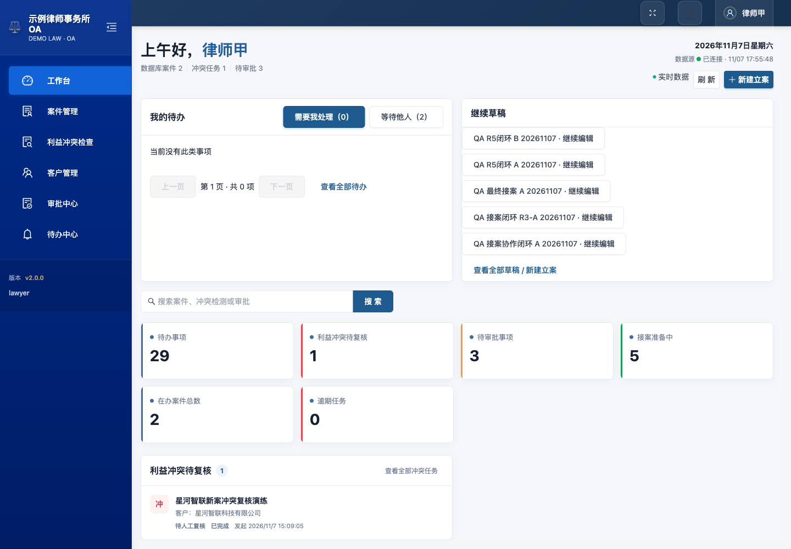
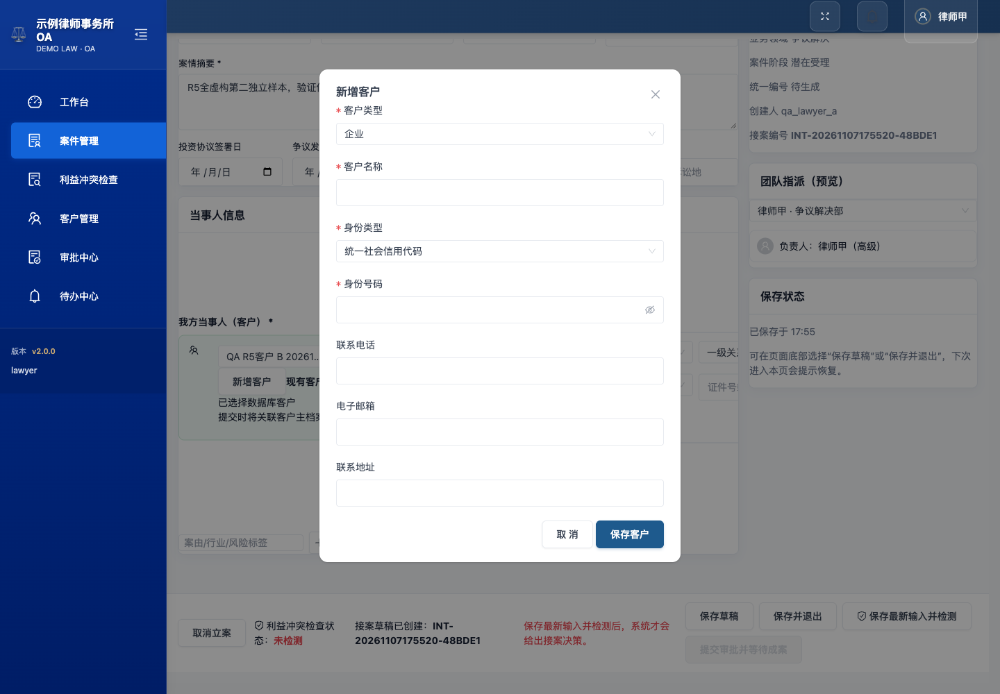
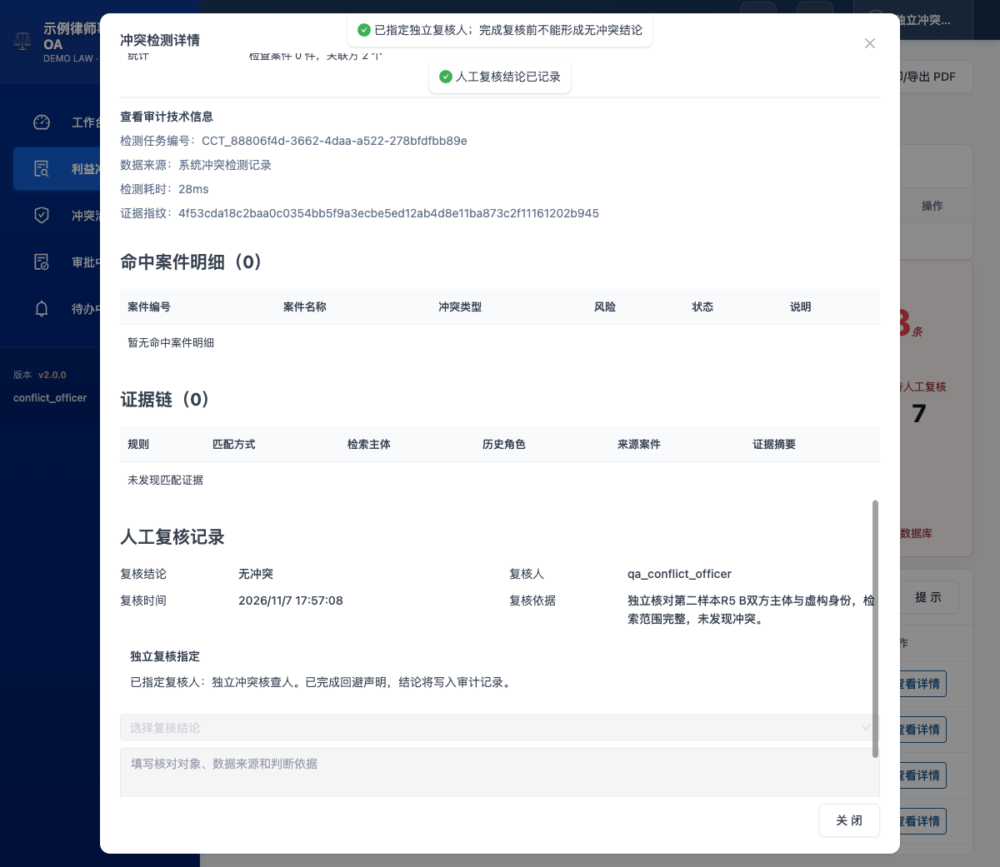
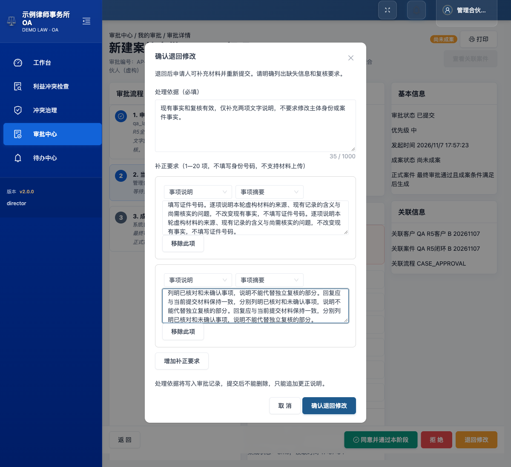
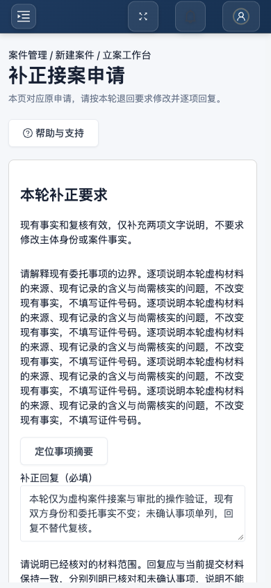
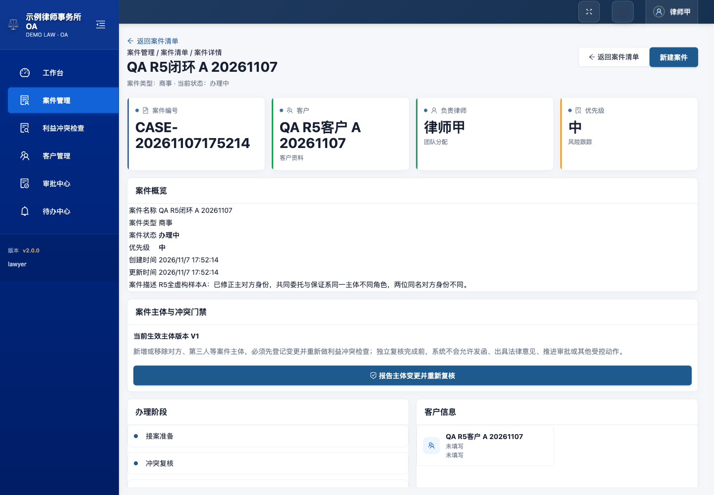

# 接案协作 MVP 试用者操作手册

本手册面向律师、助理、独立冲突核查人和业务审批人。练习请使用虚构资料。截图和操作核对来自 2026-11-07 的接案协作候选 `3f97004`，使用虚构账号；真实律师试用和正式投用尚未验收。完整核对记录见[本轮手册检查](../reports/evidence/intake-collaboration-mvp/20261107/manual-check.md)。

## 1. 系统简介

系统围绕一条接案流程工作：登记客户和接案事实 → 正式利益冲突检查 → 独立人工复核 → 接案审批 → 必要时补正原申请 → 审批通过并生成正式案件。审批通过与正式案件生成是两个可分别查看的状态。

## 2. 开始之前

请由项目负责人提供已开通的账号和试用地址。申请律师、独立核查人、业务审批人使用各自账号；申请人不能审批自己的申请。纯冲突核查岗不能代替律师填写或保存接案事实。助理按已授权范围协助整理草稿，不能代替律师确认事实或独立核查。

练习前准备案件名称、客户名称与身份标识、对方名称与身份标识、案件类型、业务领域、子领域、负责律师和案情摘要。不要把真实证件或客户资料用于测试。

## 3. 登录与退出

1. 在登录页输入账号或邮箱、密码，点击 **登录**。
2. 登录后先看右上角姓名，确认当前角色。
3. 切换角色时，点击右上角用户菜单 → **退出登录**，再用另一账号登录。

不要只更换页面中的姓名来代替切换账号。窄屏下先打开导航菜单，再选择业务入口。

## 4. 认识工作台

**我的待办**分为 **需要我处理** 与 **等待他人**。需要处理的事项提供业务入口，例如办理审批、补充申请或复核冲突；等待事项用于了解流转进度。

**继续草稿**列出当前账号可以继续的接案。点击具体草稿标题进入该对象，先核对案件名称和接案编号。新建立案使用 **新建立案**，不要把旧草稿改名后当作新对象。

待办卡片目前使用通用事项标题。存在多条同类事项时，进入后核对案件名称、接案或审批编号，再作决定。

待办数与具体列表采用相同权限范围。没有权限的对象不会因为出现旧提醒就自动变为可访问；角色或指派变化后应刷新页面。

## 5. 一次完整练习

律师新建客户并保存接案 → 正式检测 → 核查岗指定独立复核人并形成结论 → 律师提交接案审批 → 审批人退回两项补充要求 → 律师从待办进入原申请逐项回复 → 必要时修改事实、重新检测和独立复核 → 重新提交原审批 → 审批人审查当前版本 → 查看正式案件。

每一步都核对同一案件名称和接案编号。补正沿用原审批，不另外发起一张申请代替原流程。

## 6. 新建立案、原地新增客户与保存

1. 工作台点击 **新建立案**，填写案件名称、案件类型、业务领域、子领域和案情摘要。
2. 在“我方当事人（客户）”搜索已有客户；客户较多时使用列表分页。遇到同名客户，核对具体档案，不按名称自动合并。
3. 若客户尚未建档，点击 **新增客户**。填写客户类型、名称、身份类型和身份号码，点击 **保存客户**。成功后弹窗关闭，当前立案会直接选中这个客户；原立案输入保留。
4. 取消弹窗不会创建客户。若保存提示结果尚未确认，保持客户内容不变重试；不要连续新开多个请求。客户已建档但立案保存失败时，保留已选客户，再重试保存立案即可。
5. 填写对方名称、主体类型、身份类型和身份标识；需要时添加其他相关方及其真实业务角色。同一主体担任多个角色时分别登记对应角色。
6. 选择负责律师。点击 **保存草稿** 留在当前页面，或 **保存并退出** 后返回案件管理。需要继续时，从导航进入 **工作台**，在 **继续草稿** 中选择原案件。
7. 准备好正式核对的事实后，点击 **保存最新输入并检测**。

保存状态有“未保存修改”“保存中”“已保存”“保存失败”。按钮被点击不等于已经保存；以保存成功状态为准。保存期间继续输入的内容仍需再次保存。

另一窗口已经保存同一草稿时，旧窗口会收到版本冲突提示。保留本窗口的未保存内容，重新读取服务端版本后核对；不要反复提交覆盖。离开有未保存修改的页面时，可选择保存后离开、放弃本次未保存修改或继续编辑。

身份标识按受保护方式保存。再次打开时可能显示已登记或遮罩，不显示原号码；确需变更时重新输入。不要把遮罩文本当作真实身份号码提交。

## 7. 利益冲突检查与独立复核

自动检索完成不等于已经确认无冲突。检查页会显示当前接案、客户、对方、检测任务和处置状态。

核查岗在 **利益冲突检查** 找到对应案件，点击 **查看详情**。尚未指定复核人时，在 **独立复核指定** 选择符合回避要求的人员，点击 **指定并声明回避**。被指定人员用自己的账号打开同一任务，选择复核结论，填写核对对象、数据来源和判断依据，点击 **提交人工复核结论**。

业务审批不能替代独立复核。修改身份、当事人角色或其他影响检索的事实后，原检测和复核可能失效；按提示重新检测并由独立人员复核。仅补充文字说明是否可以沿用当前结论，由服务端核验。

完成指派后，被指定核查人的工作台会出现 **独立复核**。点击后直接打开对应检测详情；完成复核后，该办理项从需要处理列表移除。

## 8. 审批、退回补正与重新提交

### 8.1 律师提交

接案事实、正式检测和独立复核满足要求后，在原接案点击 **提交审批并等待成案**。保存审批编号，后续从工作台、待办或审批中心进入同一申请。

### 8.2 审批人审查与退回

打开审批详情，核对当前提交版本、案件主体、材料和复核信息。需要补充时选择退回补充，填写退回原因并逐项列明补充要求；选择对应类别、字段或当事人，写清需要补充什么。不要把完整证件号码写入意见。

当前版本变化后，原页面不能继续作决定。收到版本变化提示时刷新并审查新材料。历史提交仅供查看，不在历史版本上审批。

### 8.3 律师补正

1. 从 **需要我处理** 中进入 **补充申请**，确认接案和审批均为原对象。
2. 阅读 **本轮补正要求**。点击相应定位按钮可进入对应字段或当事人。
3. 在每一项下填写 **补正回复**，点击 **保存逐项回复**。关闭并重新打开后核对已保存回复。
4. 如需更改实际事实，另行保存草稿；按页面要求重新进行正式检测和独立复核。只写“已核验”不能代替这些步骤。
5. 填写修改说明，点击 **重新提交原审批**。成功后仍是原审批编号，材料形成新提交版本。

重复发送同一份重提请求应回到已经提交的版本。若退回记录或草稿版本已经变化，按提示重新读取；不要修改旧补充项编号或拼接其他审批的链接。

### 8.4 成案与重试

审批人点击 **同意并通过本阶段**，填写处理依据后确认。如果还存在下一审批节点，系统继续交接，不会立即生成案件。最后一节点通过后，查看“成案状态”和“正式案件”，点击 **查看关联案件**。

若显示成案失败，从审批详情查看错误并按权限重试；不要重新创建一张审批或一份案件。重试成功仍应指向同一个正式案件。

## 9. 案件管理

从 **案件管理** 或审批的 **查看关联案件** 打开正式案件，核对案件名称、客户、负责律师和补正后的案件描述。当前详情页显示生效主体版本，但不逐条列出全部主体角色；完整主体核对需由项目负责人结合批准材料和主体记录完成。发现缺失或不一致时记录案件编号和操作步骤，交项目负责人核查。

## 10. 客户管理

**客户管理**与立案页的 **新增客户**使用同一份客户建档表单。新建前先搜索已有档案；同名不等于同一主体。没有权限的客户不会因为知道编号而开放。

## 11. 待办中心

- **需要我处理**：进入业务页面完成当前任务。
- **等待他人**：查看当前责任人与流转状态。
- **已处理／结果提醒**：查看已发生的审批或复核结果；其中仍可能显示尚未成案或成案失败，应继续核对具体状态。

业务流程待办不能用“标记完成”或删除来代替处理。**延后提醒**只改变提醒时间，不延长业务期限，也不会让当前办理职责消失。普通个人提醒可以正常标记完成；历史无法关联的提醒可以归档，归档不改变业务结果。

## 12. 常见问题

| 看到的情况 | 如何处理 |
| --- | --- |
| 客户保存结果不确定 | 保持原客户内容重试，核对返回的同一客户；不要立即再建一份 |
| 客户已创建，立案未保存 | 继续使用已选客户，修正立案错误后重试 |
| 页面提示“请提供认证令牌”或登录已过期 | 先记录尚未保存的非敏感输入，再退出并重新登录；从工作台恢复已保存草稿。身份号码不会在本机草稿中保留，不能承诺恢复未保存的原号码 |
| 草稿已经被更新 | 保留输入，重新读取最新草稿，核对差异后保存 |
| 原检测失效 | 保存事实，重新检测并完成独立复核 |
| 只写了回复但仍不能重提 | 看具体缺项；回复不代替字段修改、身份保护或复核结论 |
| 补充项对应的当事人已删除 | 不改填相邻当事人，请审批人确认补充对象 |
| 历史快照来源无法确认 | 停留在只读状态，交项目负责人核对；不选一个较新时间来代替 |
| 旧待办无办理按钮 | 查看来源说明，刷新权限和任务状态；不自行拼接对象编号 |
| 审批通过但未生成正式案件 | 查看成案子状态，按授权从原审批重试 |
| 只有角色菜单不同 | 先确认登录账号；菜单隐藏不能代替业务权限核验 |

## 13. 术语

**接案草稿**：尚未完成成案的申请资料。**正式检测**：针对已确认事实执行并保存的检索。**独立复核**：被指定且满足回避要求的人员形成的核查结论。**提交版本**：某轮审批使用的固定材料。**补正**：依据当前退回意见修改原申请并逐项回复。**成案**：正式案件及主体完整建立并关联原审批。

## 14. 本轮边界与反馈

本轮覆盖原地建客户、精确草稿恢复、可办理待办、结构化退回、原审批重提和成案一致性。未开放的菜单或能力不因本手册而获得授权。

本地虚构数据的工程与页面检查不能代替真实律师试用、正式环境验收、备份恢复或灾备演练。发现问题时记录当前角色、页面标题、接案/审批/案件编号、实际提示、操作顺序和时间；不要提交密码或完整身份号码。

本候选的完整验收结论、已测与未测项目以本轮 C01—C18 证据矩阵为准。
